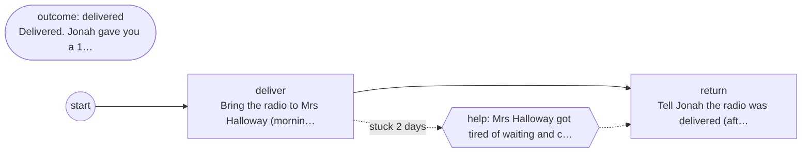
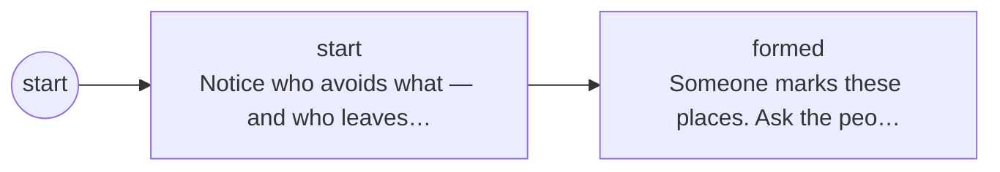
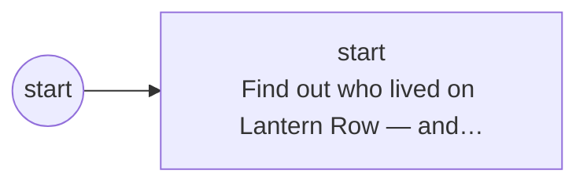
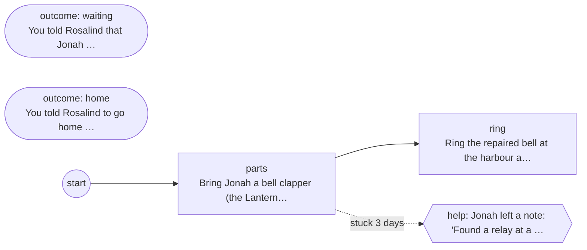
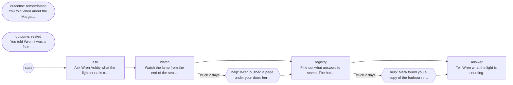

# Case graphs

Generated by `tools/content_graphs.py` — do not edit by hand.
Solid arrows: declared stage transitions. Dotted: fail-forward help the game gives if the player is stuck.

## case_door — The Door That Shouldn't Be There

## case_radio — Rook's Radio

## case_quiet — Greyford Keeps Quiet

## case_lantern_row — Lantern Row

## case_rosalind — The Girl Who Wasn't Counted

Evidence that advances this case: `e_census_page`

## case_eleventh — The Eleventh House

Evidence that advances this case: `e_agnes_file`

## case_bell — The Bell at Harbour Stop

## case_letters — Letters to No One

## case_lighthouse — The Light That Counts

Evidence that advances this case: `e_flash_count`, `e_ship_register`

