# Case graphs

Generated by `tools/content_graphs.py` — do not edit by hand.
Solid arrows: declared stage transitions. Dotted: fail-forward help the game gives if the player is stuck.

## case_two_maps — The City Has Two Maps

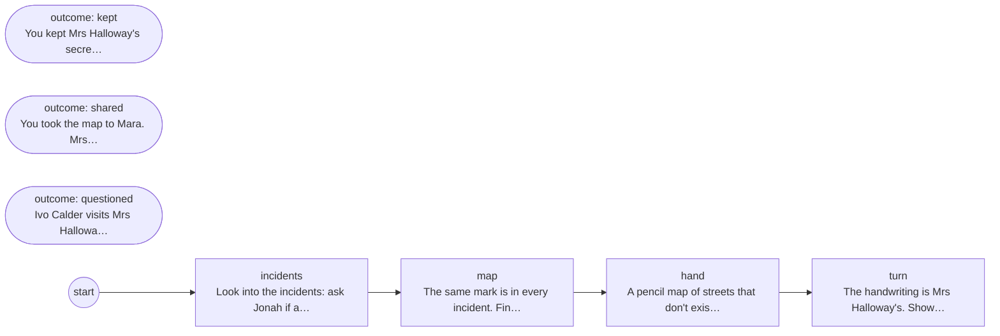

Evidence that advances this case: `e_two_maps`

## case_storeroom — The Missing Storeroom

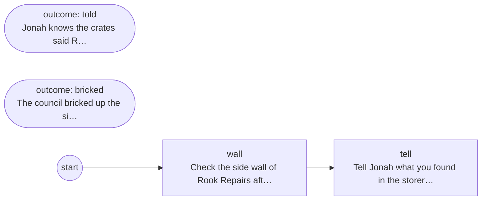

Evidence that advances this case: `e_storeroom_mark`

## case_larger_house — The House That Grew

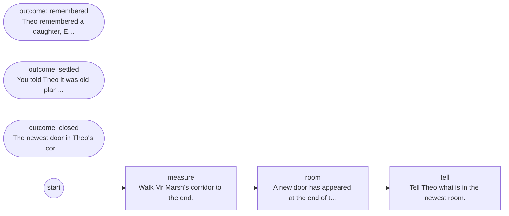

Evidence that advances this case: `e_house_longer`, `e_house_mark`

## case_misplaced — The People We Misplaced


## case_kindness — A Kindness Built on a Lie

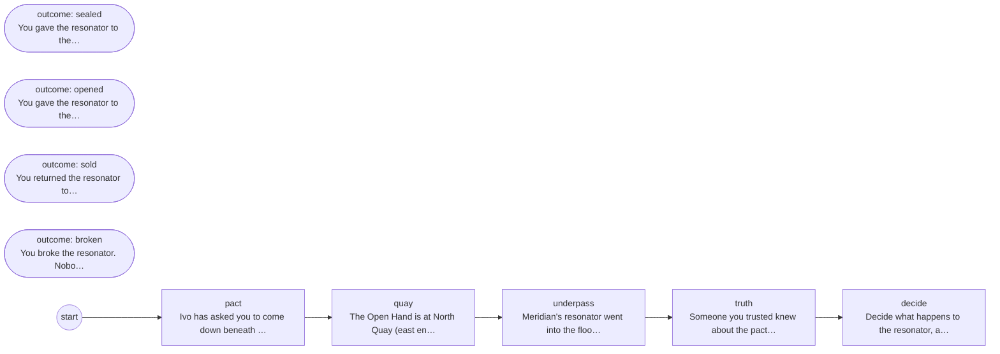

## case_index — The Index

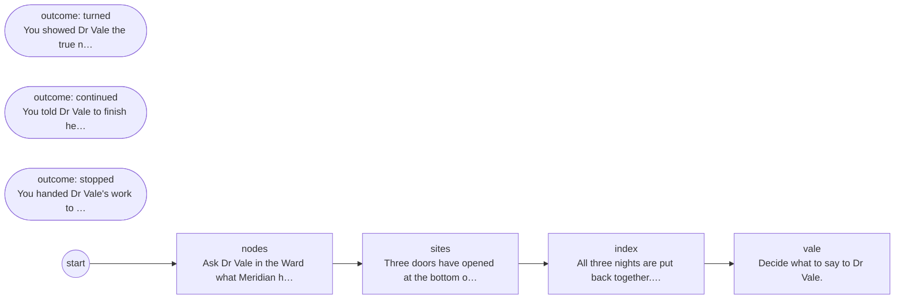

## case_anchor — What We Choose to Remember

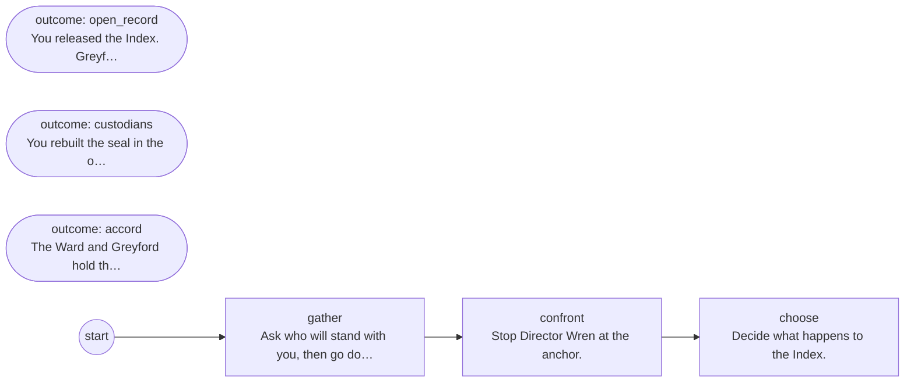

## case_original_card — A specimen

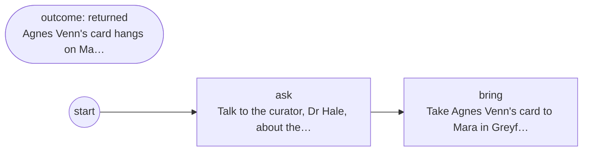

## case_dead_letters — Dead letters

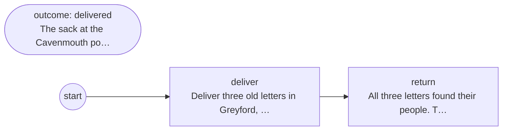

## case_agnes — Agnes's Last Card

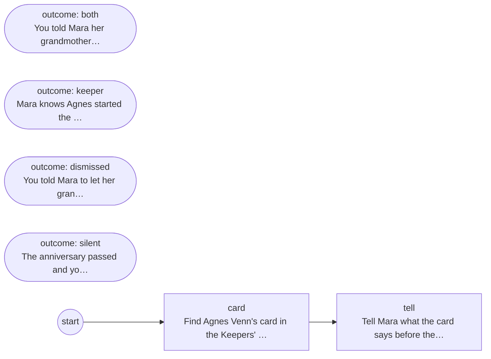

Evidence that advances this case: `e_agnes_card`

## case_rook_and_rook — Rook & Rook


Evidence that advances this case: `e_rook_stamp`

## case_brook_farm — Brookside

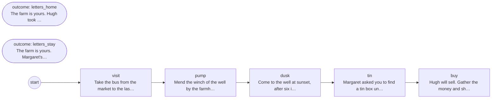

## case_door — The Door That Shouldn't Be There

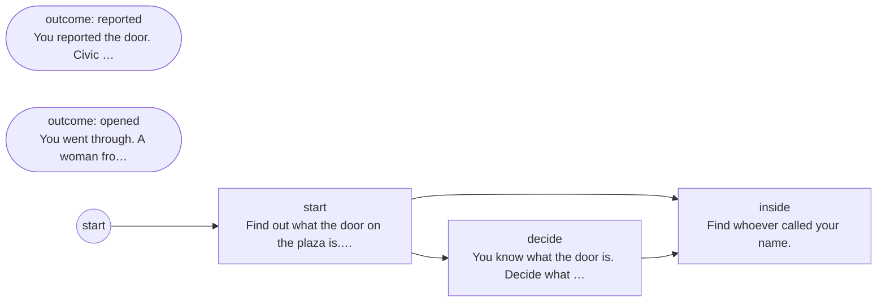

## case_radio — Rook's Radio


## case_quiet — Greyford Keeps Quiet

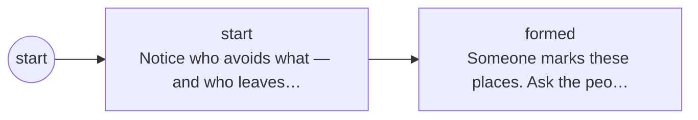

## case_lantern_row — Lantern Row

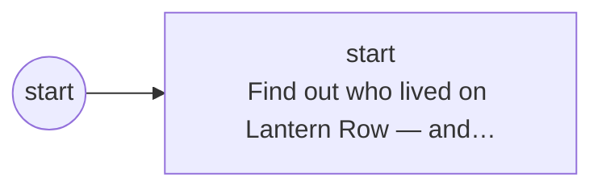

## case_rosalind — The Girl Who Wasn't Counted

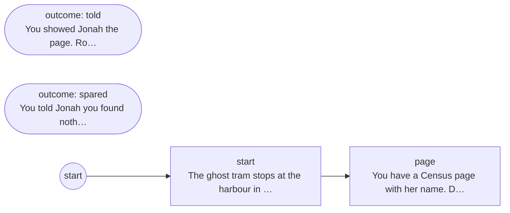

Evidence that advances this case: `e_census_page`

## case_eleventh — The Eleventh House

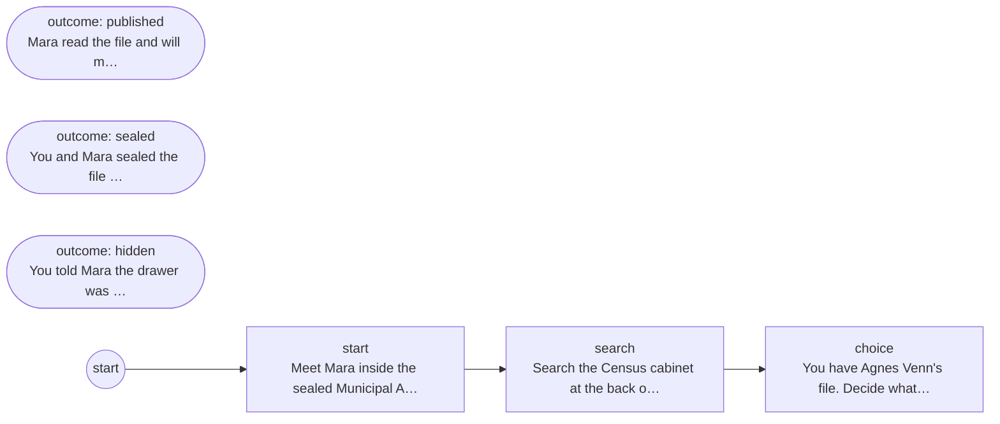

Evidence that advances this case: `e_agnes_file`

## case_bell — The Bell at Harbour Stop


## case_letters — Letters to No One


## case_inc_lanterns — Lantern Row Is Singing

```mermaid
flowchart LR
  case_inc_lanterns_clear["clear<br/>Quiet the echoes on Lantern Row."]
  case_inc_lanterns_report["report<br/>Tell Mara the row is quiet."]
  case_inc_lanterns_clear --> case_inc_lanterns_report
  case_inc_lanterns_out_resolved(["outcome: resolved<br/>Done, and reported."])
  case_inc_lanterns_out_missed(["outcome: missed<br/>Someone else had to go down t…"])
  case_inc_lanterns_START(("start")) --> case_inc_lanterns_clear
```

## case_inc_storeroom — Something in the Stock

```mermaid
flowchart LR
  case_inc_storeroom_clear["clear<br/>Clear the Rook storeroom."]
  case_inc_storeroom_report["report<br/>Tell Jonah the storeroom is safe."]
  case_inc_storeroom_clear --> case_inc_storeroom_report
  case_inc_storeroom_out_resolved(["outcome: resolved<br/>Done, and reported."])
  case_inc_storeroom_out_missed(["outcome: missed<br/>The storeroom stays bricked u…"])
  case_inc_storeroom_START(("start")) --> case_inc_storeroom_clear
```

## case_inc_last_tram — The 11:40 Runs Again

```mermaid
flowchart LR
  case_inc_last_tram_clear["clear<br/>Clear the phantom platform."]
  case_inc_last_tram_report["report<br/>Report to Ivo."]
  case_inc_last_tram_clear --> case_inc_last_tram_report
  case_inc_last_tram_out_resolved(["outcome: resolved<br/>Done, and reported."])
  case_inc_last_tram_out_missed(["outcome: missed<br/>The bell rang again. Ivo stop…"])
  case_inc_last_tram_START(("start")) --> case_inc_last_tram_clear
```

## case_inc_names — The Queue of Names

```mermaid
flowchart LR
  case_inc_names_clear["clear<br/>Settle the echoes in the underpass arch…"]
  case_inc_names_report["report<br/>Tell the Alderman."]
  case_inc_names_clear --> case_inc_names_report
  case_inc_names_out_resolved(["outcome: resolved<br/>Done, and reported."])
  case_inc_names_out_missed(["outcome: missed<br/>The names in the archive drow…"])
  case_inc_names_START(("start")) --> case_inc_names_clear
```

## case_inc_seal — Pressure on the Seal

```mermaid
flowchart LR
  case_inc_seal_clear["clear<br/>Clear the flooded underpass."]
  case_inc_seal_report["report<br/>Report the seal to Ivo."]
  case_inc_seal_clear --> case_inc_seal_report
  case_inc_seal_out_resolved(["outcome: resolved<br/>Done, and reported."])
  case_inc_seal_out_missed(["outcome: missed<br/>The seal held, barely. The Ke…"])
  case_inc_seal_START(("start")) --> case_inc_seal_clear
```

## case_inc_patrol — The First Joint Patrol

```mermaid
flowchart LR
  case_inc_patrol_clear["clear<br/>Clear the Ward depot."]
  case_inc_patrol_report["report<br/>Tell Sera Vale."]
  case_inc_patrol_clear --> case_inc_patrol_report
  case_inc_patrol_out_resolved(["outcome: resolved<br/>Done, and reported."])
  case_inc_patrol_out_missed(["outcome: missed<br/>The first patrol was a shouti…"])
  case_inc_patrol_START(("start")) --> case_inc_patrol_clear
```

## case_lighthouse — The Light That Counts

```mermaid
flowchart LR
  case_lighthouse_ask["ask<br/>Ask Hester Ashby what the lighthouse is…"]
  case_lighthouse_watch["watch<br/>Watch the lamp from the end of the sea …"]
  case_lighthouse_registry["registry<br/>Find out what answers to seven. The har…"]
  case_lighthouse_answer["answer<br/>Tell Hester what the light is counting."]
  case_lighthouse_ask --> case_lighthouse_watch
  case_lighthouse_watch --> case_lighthouse_registry
  case_lighthouse_registry --> case_lighthouse_answer
  case_lighthouse_out_remembered(["outcome: remembered<br/>You told Hester about the Mar…"])
  case_lighthouse_out_rested(["outcome: rested<br/>You told Hester it was a faul…"])
  case_lighthouse_out_missed(["outcome: missed<br/>You never came to watch. The …"])
  case_lighthouse_START(("start")) --> case_lighthouse_ask
```

Evidence that advances this case: `e_flash_count`, `e_ship_register`

## case_drowned_ford — The bell under the water

```mermaid
flowchart LR
  case_drowned_ford_listen["listen<br/>Go to the end of the pier after dark an…"]
  case_drowned_ford_below["below<br/>Go down to Mill Ford and find the paris…"]
  case_drowned_ford_choice["choice<br/>Bring the register to Ada and decide wh…"]
  case_drowned_ford_listen --> case_drowned_ford_below
  case_drowned_ford_below --> case_drowned_ford_choice
  case_drowned_ford_out_remembered(["outcome: remembered<br/>Ada took the register to the …"])
  case_drowned_ford_out_laid_to_rest(["outcome: laid_to_rest<br/>The register went back to the…"])
  case_drowned_ford_START(("start")) --> case_drowned_ford_listen
```

