# Dialogue graphs

Generated by `tools/content_graphs.py` — do not edit by hand.

## act1.json

### theo

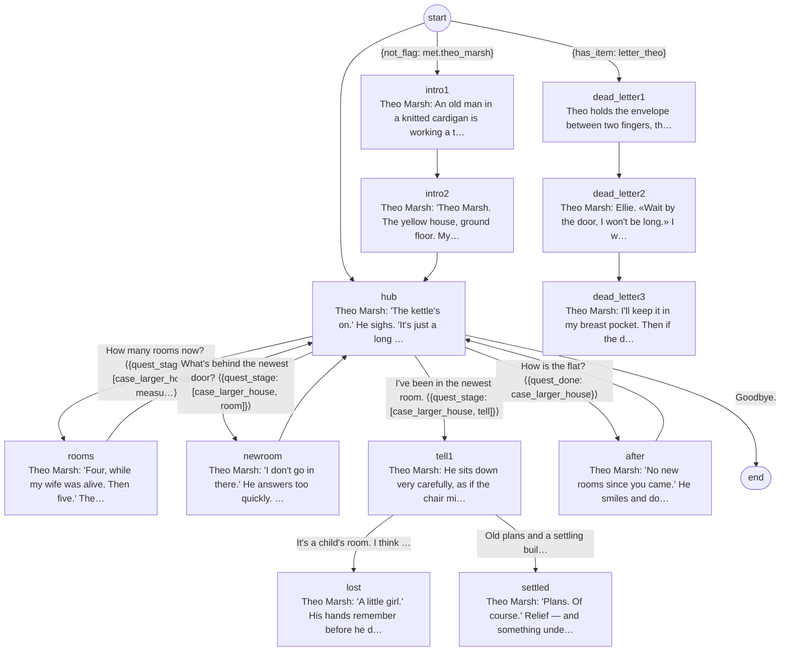

### theo_corridor


### new_room_enter

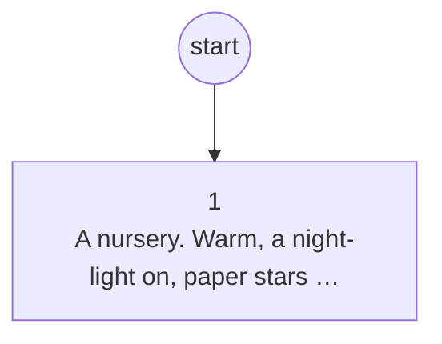

### new_room_bed

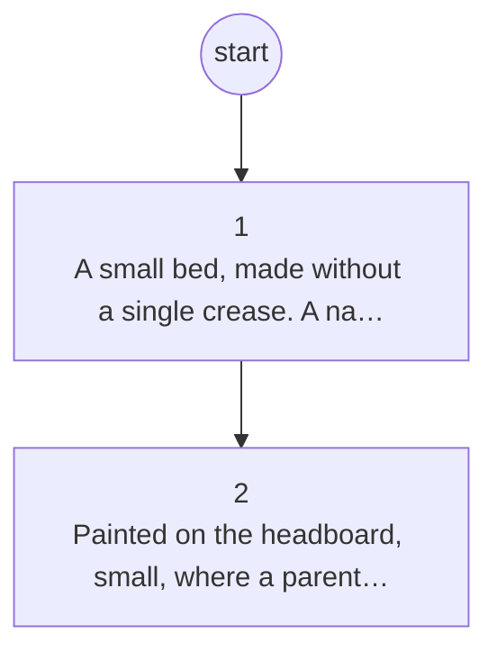

### new_room_desk

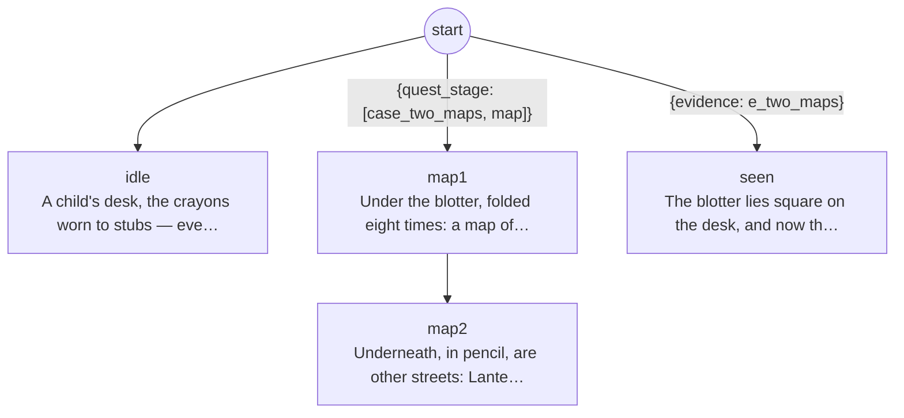

### storeroom_enter

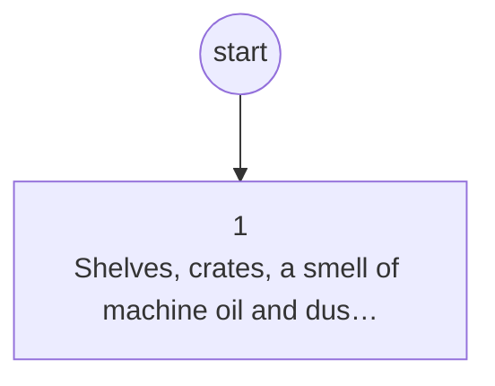

### storeroom_crate

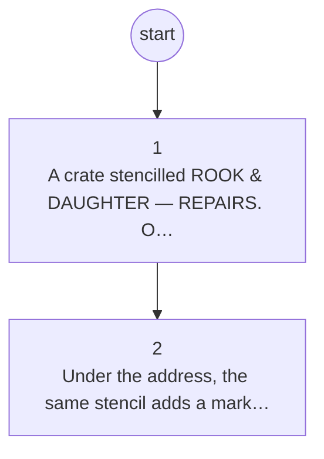

### storeroom_ledger

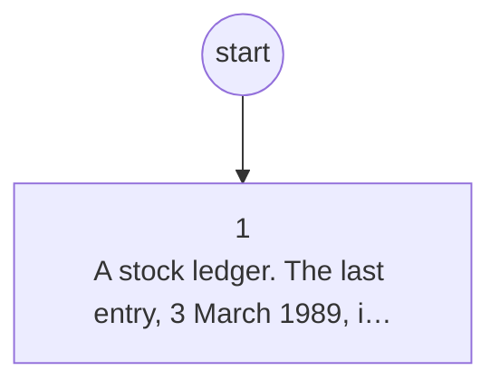

## act2.json

### ward_enter

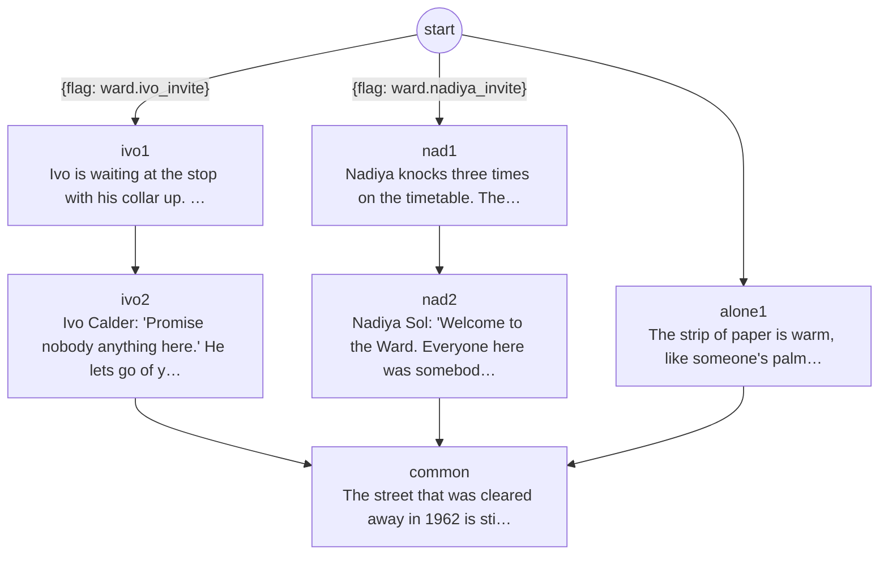

### depot_enter

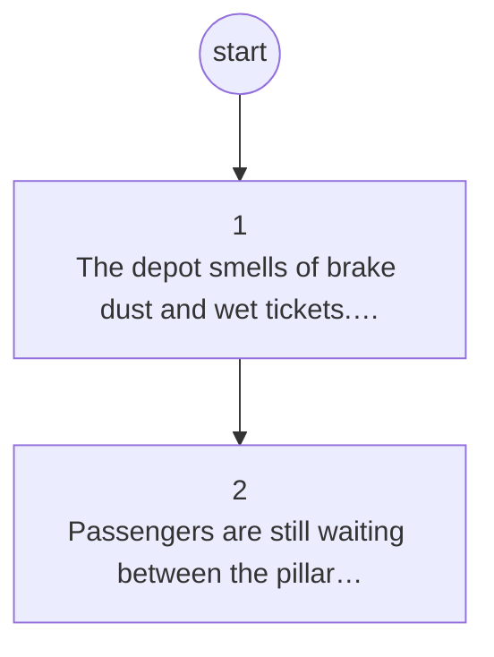

### platform_conductor

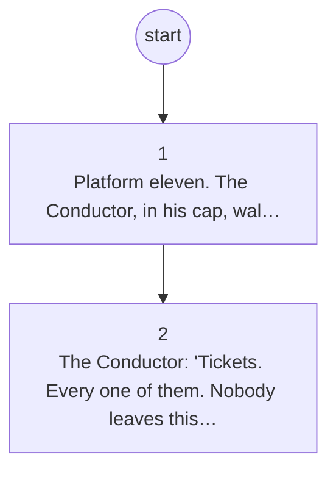

### alderman

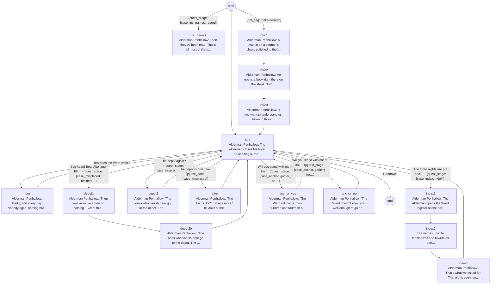

### bea

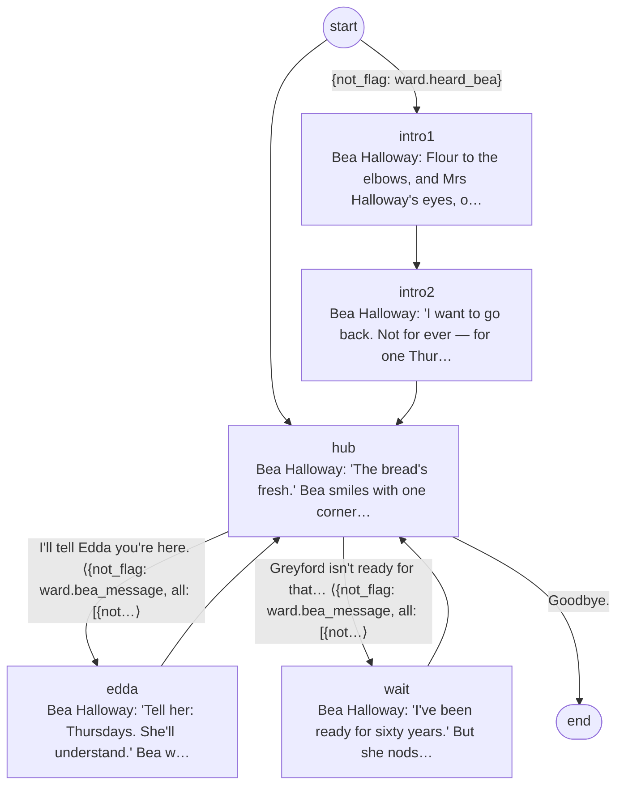

### abel

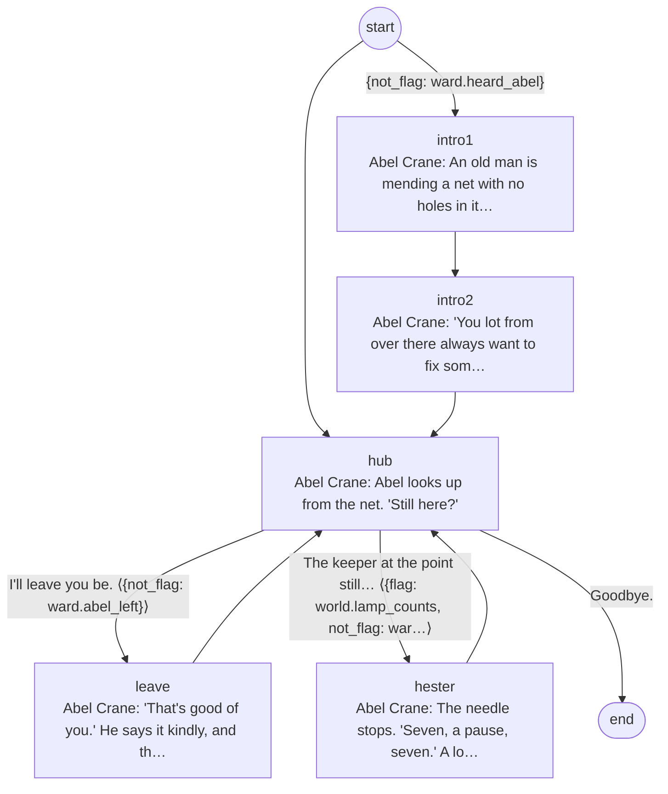

### ellie

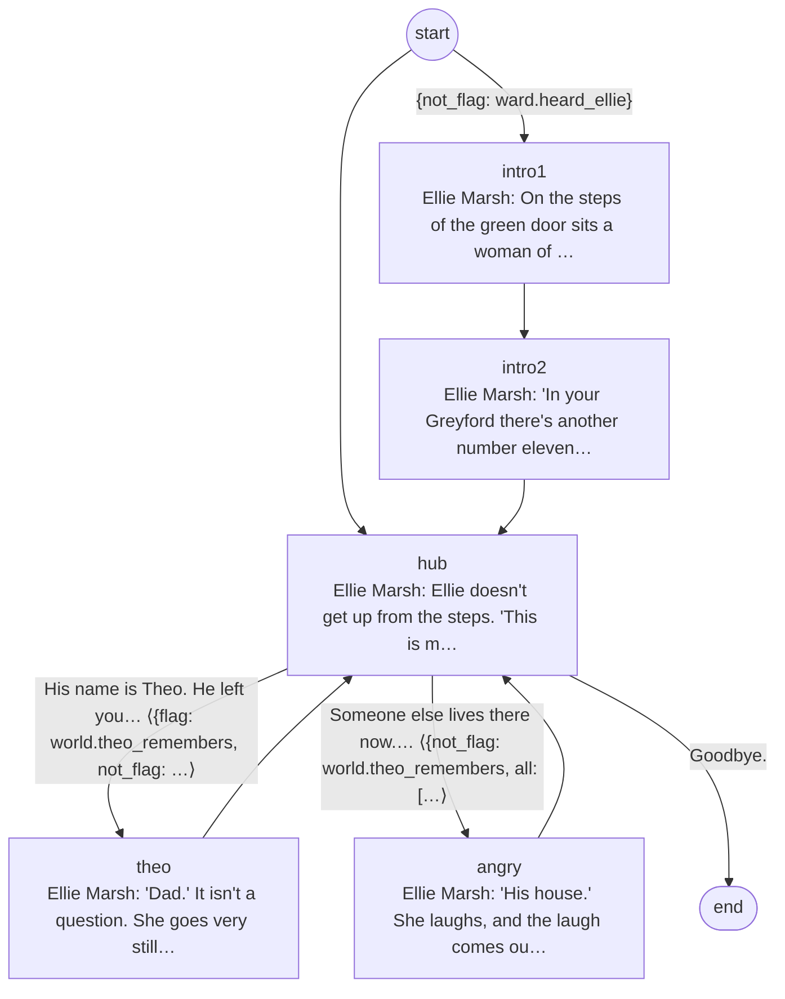

### vale

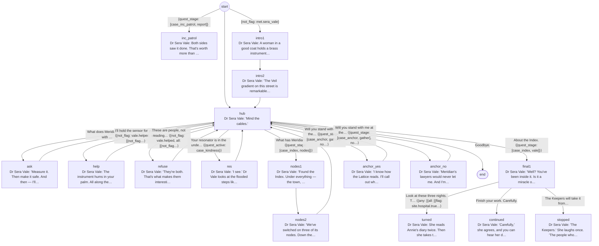

### rosalind

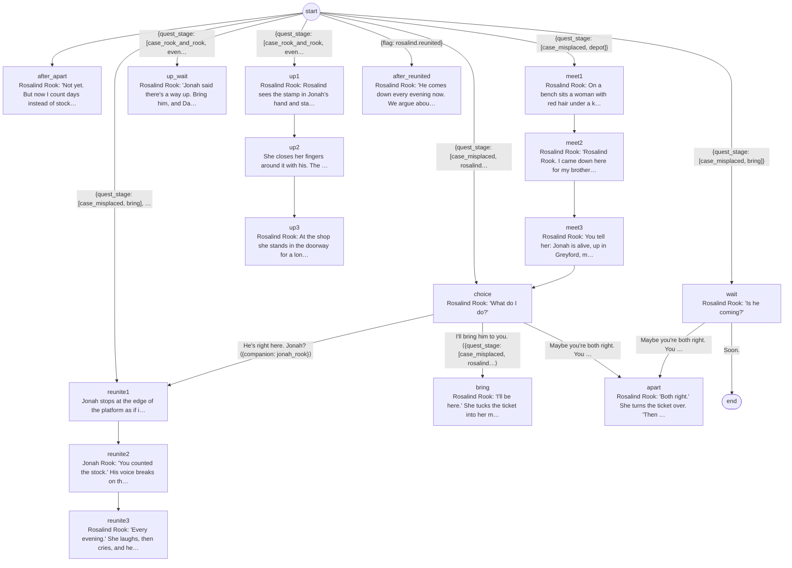

### camp_jonah

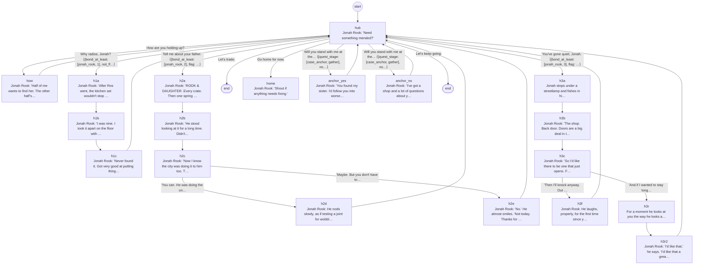

### camp_mara

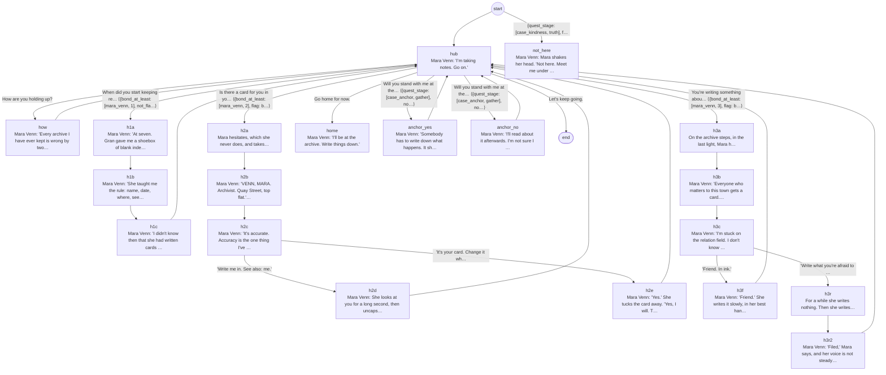

### harbour_timetable

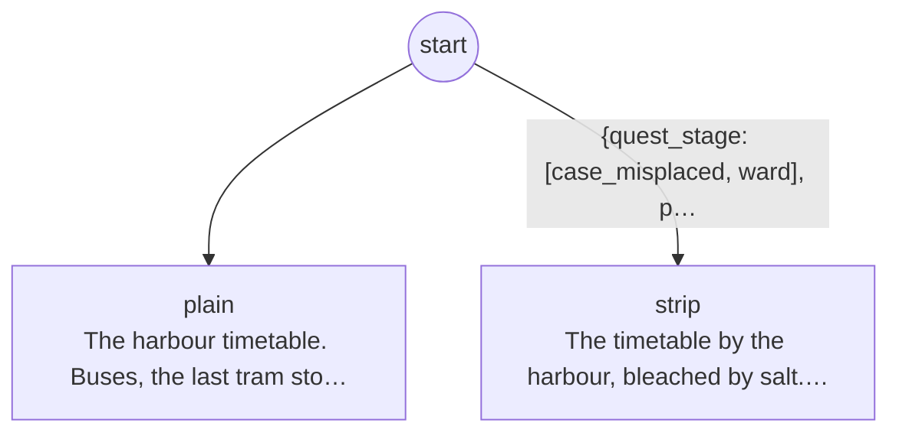

## act3.json

### keepers_enter

```mermaid
flowchart TD
  keepers_enter_START(("start"))
  keepers_enter_START --> keepers_enter_1
  keepers_enter_1["1<br/>Under the archive there is an older room — the …"]
  keepers_enter_1 --> keepers_enter_2
  keepers_enter_2["2<br/>Ivo Calder: Ivo is waiting at the table, hands folded. 'The…"]
  keepers_enter_2 --> keepers_enter_3
  keepers_enter_3["3<br/>Ivo Calder: 'Halfway. For ever. That's the bargain.' He str…"]
  keepers_enter_3 --> keepers_enter_4
  keepers_enter_4["4<br/>Ivo Calder: 'And now the Open Hand want to tear it up. Nadi…"]
```

### seal_engine

```mermaid
flowchart TD
  seal_engine_START(("start"))
  seal_engine_START --> seal_engine_idle
  seal_engine_START -->|"{quest_stage: [case_kindness, decide]}"| seal_engine_decide1
  seal_engine_START -->|"{quest_done: case_kindness}"| seal_engine_after
  seal_engine_idle["idle<br/>The Seal hums its one low note. The floor hums …"]
  seal_engine_after["after<br/>Under the floor the machine hums. Somewhere abo…"]
  seal_engine_decide1["decide1<br/>The resonator and the Seal hum one note now, lo…"]
  seal_engine_decide1 -->|"Give it to the Keepers. The s…"| seal_engine_kept
  seal_engine_decide1 -->|"Give it to Nadiya. Open the W…"| seal_engine_opened
  seal_engine_decide1 -->|"Return it to Dr Vale. Let Mer…"| seal_engine_sold
  seal_engine_decide1 -->|"Break it. Nobody should hold …"| seal_engine_broken
  seal_engine_kept["kept<br/>You fit the resonator into a socket made exactl…"]
  seal_engine_opened["opened<br/>Nadiya takes the resonator as if it were glass …"]
  seal_engine_sold["sold<br/>Dr Vale signs a receipt and counts out notes wi…"]
  seal_engine_broken["broken<br/>The resonator breaks like a bell: once, and for…"]
```

### underpass_enter

```mermaid
flowchart TD
  underpass_enter_START(("start"))
  underpass_enter_START --> underpass_enter_1
  underpass_enter_1["1<br/>The underpass is flooded in straight channels, …"]
  underpass_enter_1 --> underpass_enter_2
  underpass_enter_2["2<br/>You open one. The papers inside are perfectly d…"]
```

### archivist_enter

```mermaid
flowchart TD
  archivist_enter_START(("start"))
  archivist_enter_START --> archivist_enter_1
  archivist_enter_1["1<br/>In the middle of a dry room, black water lappin…"]
  archivist_enter_1 --> archivist_enter_2
  archivist_enter_2["2<br/>The Archivist of Fl…: He doesn't look up. 'Every record I keep is dry…"]
```

### resonator_found

```mermaid
flowchart TD
  resonator_found_START(("start"))
  resonator_found_START --> resonator_found_1
  resonator_found_1["1<br/>Among the dry files lies a brass instrument the…"]
  resonator_found_1 --> resonator_found_2
  resonator_found_2["2<br/>It is warm in your hands — warmer than brass sh…"]
```

## act4.json

### hospital_enter

```mermaid
flowchart TD
  hospital_enter_START(("start"))
  hospital_enter_START --> hospital_enter_1
  hospital_enter_1["1<br/>The night of 11 November 1962, as St Agnes reme…"]
  hospital_enter_1 --> hospital_enter_2
  hospital_enter_2["2<br/>Someone in a starched cap is going through the …"]
```

### home_enter

```mermaid
flowchart TD
  home_enter_START(("start"))
  home_enter_START --> home_enter_1
  home_enter_1["1<br/>A kitchen on Lantern Row. Supper half laid. Pen…"]
  home_enter_1 --> home_enter_2
  home_enter_2["2<br/>A man in a lodger's cardigan is rearranging the…"]
```

### station_enter

```mermaid
flowchart TD
  station_enter_START(("start"))
  station_enter_START --> station_enter_1
  station_enter_1["1<br/>Lantern Row station at 11:51. The platform is f…"]
  station_enter_1 --> station_enter_2
  station_enter_2["2<br/>The stationmaster turns the board from 11:52 to…"]
```

### t_nurse_log

```mermaid
flowchart TD
  t_nurse_log_START(("start"))
  t_nurse_log_START --> t_nurse_log_1
  t_nurse_log_START -->|"{flag: site.hospital.done}"| t_nurse_log_done
  t_nurse_log_1["1<br/>Night nurse's log, in a quick, even hand: '23:5…"]
  t_nurse_log_1 --> t_nurse_log_judge
  t_nurse_log_judge["judge<br/>How do you judge this account?"]
  t_nurse_log_judge_end_0(["end"])
  t_nurse_log_judge -->|"Authentic — it happened like …"| t_nurse_log_judge_end_0
  t_nurse_log_judge_end_1(["end"])
  t_nurse_log_judge -->|"Edited — someone changed it a…"| t_nurse_log_judge_end_1
  t_nurse_log_judge_end_2(["end"])
  t_nurse_log_judge -->|"Unreliable — the witness can'…"| t_nurse_log_judge_end_2
  t_nurse_log_judge_end_3(["end"])
  t_nurse_log_judge -->|"Decide later."| t_nurse_log_judge_end_3
  t_nurse_log_done["done<br/>Night nurse's log, in a quick, even hand: '23:5…"]
```

### t_admissions

```mermaid
flowchart TD
  t_admissions_START(("start"))
  t_admissions_START --> t_admissions_1
  t_admissions_START -->|"{flag: site.hospital.done}"| t_admissions_done
  t_admissions_1["1<br/>The admissions register. The night's page reads…"]
  t_admissions_1 --> t_admissions_judge
  t_admissions_judge["judge<br/>How do you judge this account?"]
  t_admissions_judge_end_0(["end"])
  t_admissions_judge -->|"Authentic — it happened like …"| t_admissions_judge_end_0
  t_admissions_judge_end_1(["end"])
  t_admissions_judge -->|"Edited — someone changed it a…"| t_admissions_judge_end_1
  t_admissions_judge_end_2(["end"])
  t_admissions_judge -->|"Unreliable — the witness can'…"| t_admissions_judge_end_2
  t_admissions_judge_end_3(["end"])
  t_admissions_judge -->|"Decide later."| t_admissions_judge_end_3
  t_admissions_done["done<br/>The admissions register. The night's page reads…"]
```

### t_doctor

```mermaid
flowchart TD
  t_doctor_START(("start"))
  t_doctor_START --> t_doctor_1
  t_doctor_START -->|"{flag: site.hospital.done}"| t_doctor_done
  t_doctor_1["1<br/>Dr Hale's statement, dated 1987: 'A gas leak ca…"]
  t_doctor_1 --> t_doctor_judge
  t_doctor_judge["judge<br/>How do you judge this account?"]
  t_doctor_judge_end_0(["end"])
  t_doctor_judge -->|"Authentic — it happened like …"| t_doctor_judge_end_0
  t_doctor_judge_end_1(["end"])
  t_doctor_judge -->|"Edited — someone changed it a…"| t_doctor_judge_end_1
  t_doctor_judge_end_2(["end"])
  t_doctor_judge -->|"Unreliable — the witness can'…"| t_doctor_judge_end_2
  t_doctor_judge_end_3(["end"])
  t_doctor_judge -->|"Decide later."| t_doctor_judge_end_3
  t_doctor_done["done<br/>Dr Hale's statement, dated 1987: 'A gas leak ca…"]
```

### recon_memory_hospital

```mermaid
flowchart TD
  recon_memory_hospital_START(("start"))
  recon_memory_hospital_START --> recon_memory_hospital_wait
  recon_memory_hospital_START -->|"{flag: site.hospital.done}"| recon_memory_hospital_after
  recon_memory_hospital_START -->|"{judged: [e_t_nurse_log, e_t_admissions…"| recon_memory_hospital_r1
  recon_memory_hospital_wait["wait<br/>The night won't come together yet. Judge every …"]
  recon_memory_hospital_after["after<br/>The records room, as you put it back together: …"]
  recon_memory_hospital_r1["r1<br/>You lay the three accounts side by side and let…"]
```

### t_child_diary

```mermaid
flowchart TD
  t_child_diary_START(("start"))
  t_child_diary_START --> t_child_diary_1
  t_child_diary_START -->|"{flag: site.home.done}"| t_child_diary_done
  t_child_diary_1["1<br/>A child's diary, round letters: 'Nov 11. Mum sa…"]
  t_child_diary_1 --> t_child_diary_judge
  t_child_diary_judge["judge<br/>How do you judge this account?"]
  t_child_diary_judge_end_0(["end"])
  t_child_diary_judge -->|"Authentic — it happened like …"| t_child_diary_judge_end_0
  t_child_diary_judge_end_1(["end"])
  t_child_diary_judge -->|"Edited — someone changed it a…"| t_child_diary_judge_end_1
  t_child_diary_judge_end_2(["end"])
  t_child_diary_judge -->|"Unreliable — the witness can'…"| t_child_diary_judge_end_2
  t_child_diary_judge_end_3(["end"])
  t_child_diary_judge -->|"Decide later."| t_child_diary_judge_end_3
  t_child_diary_done["done<br/>A child's diary, round letters: 'Nov 11. Mum sa…"]
```

### t_eviction

```mermaid
flowchart TD
  t_eviction_START(("start"))
  t_eviction_START --> t_eviction_1
  t_eviction_START -->|"{flag: site.home.done}"| t_eviction_done
  t_eviction_1["1<br/>A Borough notice on the table: PROPERTY VACANT …"]
  t_eviction_1 --> t_eviction_judge
  t_eviction_judge["judge<br/>How do you judge this account?"]
  t_eviction_judge_end_0(["end"])
  t_eviction_judge -->|"Authentic — it happened like …"| t_eviction_judge_end_0
  t_eviction_judge_end_1(["end"])
  t_eviction_judge -->|"Edited — someone changed it a…"| t_eviction_judge_end_1
  t_eviction_judge_end_2(["end"])
  t_eviction_judge -->|"Unreliable — the witness can'…"| t_eviction_judge_end_2
  t_eviction_judge_end_3(["end"])
  t_eviction_judge -->|"Decide later."| t_eviction_judge_end_3
  t_eviction_done["done<br/>A Borough notice on the table: PROPERTY VACANT …"]
```

### t_neighbour

```mermaid
flowchart TD
  t_neighbour_START(("start"))
  t_neighbour_START --> t_neighbour_1
  t_neighbour_START -->|"{flag: site.home.done}"| t_neighbour_done
  t_neighbour_1["1<br/>A neighbour's account, given gladly: 'Emigrated…"]
  t_neighbour_1 --> t_neighbour_judge
  t_neighbour_judge["judge<br/>How do you judge this account?"]
  t_neighbour_judge_end_0(["end"])
  t_neighbour_judge -->|"Authentic — it happened like …"| t_neighbour_judge_end_0
  t_neighbour_judge_end_1(["end"])
  t_neighbour_judge -->|"Edited — someone changed it a…"| t_neighbour_judge_end_1
  t_neighbour_judge_end_2(["end"])
  t_neighbour_judge -->|"Unreliable — the witness can'…"| t_neighbour_judge_end_2
  t_neighbour_judge_end_3(["end"])
  t_neighbour_judge -->|"Decide later."| t_neighbour_judge_end_3
  t_neighbour_done["done<br/>A neighbour's account, given gladly: 'Emigrated…"]
```

### recon_memory_home

```mermaid
flowchart TD
  recon_memory_home_START(("start"))
  recon_memory_home_START --> recon_memory_home_wait
  recon_memory_home_START -->|"{flag: site.home.done}"| recon_memory_home_after
  recon_memory_home_START -->|"{judged: [e_t_child_diary, e_t_eviction…"| recon_memory_home_r1
  recon_memory_home_wait["wait<br/>The night won't come together yet. Judge every …"]
  recon_memory_home_after["after<br/>The kitchen, as you put it back together. Seven…"]
  recon_memory_home_r1["r1<br/>You lay the three accounts side by side and let…"]
```

### t_station_log

```mermaid
flowchart TD
  t_station_log_START(("start"))
  t_station_log_START --> t_station_log_1
  t_station_log_START -->|"{flag: site.station.done}"| t_station_log_done
  t_station_log_1["1<br/>The stationmaster's log: '11:52 — CANCELLED.' C…"]
  t_station_log_1 --> t_station_log_judge
  t_station_log_judge["judge<br/>How do you judge this account?"]
  t_station_log_judge_end_0(["end"])
  t_station_log_judge -->|"Authentic — it happened like …"| t_station_log_judge_end_0
  t_station_log_judge_end_1(["end"])
  t_station_log_judge -->|"Edited — someone changed it a…"| t_station_log_judge_end_1
  t_station_log_judge_end_2(["end"])
  t_station_log_judge -->|"Unreliable — the witness can'…"| t_station_log_judge_end_2
  t_station_log_judge_end_3(["end"])
  t_station_log_judge -->|"Decide later."| t_station_log_judge_end_3
  t_station_log_done["done<br/>The stationmaster's log: '11:52 — CANCELLED.' C…"]
```

### t_letter

```mermaid
flowchart TD
  t_letter_START(("start"))
  t_letter_START --> t_letter_1
  t_letter_START -->|"{flag: site.station.done}"| t_letter_done
  t_letter_1["1<br/>A letter left on the bench, weighted with a tic…"]
  t_letter_1 --> t_letter_judge
  t_letter_judge["judge<br/>How do you judge this account?"]
  t_letter_judge_end_0(["end"])
  t_letter_judge -->|"Authentic — it happened like …"| t_letter_judge_end_0
  t_letter_judge_end_1(["end"])
  t_letter_judge -->|"Edited — someone changed it a…"| t_letter_judge_end_1
  t_letter_judge_end_2(["end"])
  t_letter_judge -->|"Unreliable — the witness can'…"| t_letter_judge_end_2
  t_letter_judge_end_3(["end"])
  t_letter_judge -->|"Decide later."| t_letter_judge_end_3
  t_letter_done["done<br/>A letter left on the bench, weighted with a tic…"]
```

### t_porter

```mermaid
flowchart TD
  t_porter_START(("start"))
  t_porter_START --> t_porter_1
  t_porter_START -->|"{flag: site.station.done}"| t_porter_done
  t_porter_1["1<br/>The porter, sure of it: 'The 11:52 never ran. T…"]
  t_porter_1 --> t_porter_judge
  t_porter_judge["judge<br/>How do you judge this account?"]
  t_porter_judge_end_0(["end"])
  t_porter_judge -->|"Authentic — it happened like …"| t_porter_judge_end_0
  t_porter_judge_end_1(["end"])
  t_porter_judge -->|"Edited — someone changed it a…"| t_porter_judge_end_1
  t_porter_judge_end_2(["end"])
  t_porter_judge -->|"Unreliable — the witness can'…"| t_porter_judge_end_2
  t_porter_judge_end_3(["end"])
  t_porter_judge -->|"Decide later."| t_porter_judge_end_3
  t_porter_done["done<br/>The porter, sure of it: 'The 11:52 never ran. T…"]
```

### recon_memory_station

```mermaid
flowchart TD
  recon_memory_station_START(("start"))
  recon_memory_station_START --> recon_memory_station_wait
  recon_memory_station_START -->|"{flag: site.station.done}"| recon_memory_station_after
  recon_memory_station_START -->|"{judged: [e_t_station_log, e_t_letter, …"| recon_memory_station_r1
  recon_memory_station_wait["wait<br/>The night won't come together yet. Judge every …"]
  recon_memory_station_after["after<br/>The platform, as you put it back together. The …"]
  recon_memory_station_r1["r1<br/>You lay the three accounts side by side and let…"]
```

## act5.json

### anchor_enter

```mermaid
flowchart TD
  anchor_enter_START(("start"))
  anchor_enter_START --> anchor_enter_1
  anchor_enter_1["1<br/>Under the Seal Engine, under the Keepers' hall,…"]
  anchor_enter_1 --> anchor_enter_2
  anchor_enter_2["2<br/>Director Elias Wren: 'Elias Wren. Civic Renewal.' He doesn't turn ro…"]
  anchor_enter_2 --> anchor_enter_3
  anchor_enter_3["3<br/>Director Elias Wren: 'Forty thousand people live on top of this. I c…"]
  anchor_enter_3 --> anchor_enter_4
  anchor_enter_4["4<br/>Director Elias Wren: He turns, finally, and the anchor turns with hi…"]
```

### anchor_heart

```mermaid
flowchart TD
  anchor_heart_START(("start"))
  anchor_heart_START --> anchor_heart_idle
  anchor_heart_START -->|"{quest_stage: [case_anchor, confront], …"| anchor_heart_h1
  anchor_heart_START -->|"{quest_stage: [case_anchor, choose]}"| anchor_heart_choose
  anchor_heart_START -->|"{quest_done: case_anchor}"| anchor_heart_after
  anchor_heart_idle["idle<br/>The anchor hums one note under every other note…"]
  anchor_heart_after["after<br/>The anchor hums. It sounds different now. You c…"]
  anchor_heart_h1["h1<br/>Director Elias Wren: Wren is on his knees by the anchor, coat torn, …"]
  anchor_heart_h1 --> anchor_heart_h2
  anchor_heart_h2["h2<br/>Your hand on the anchor. It shows you everythin…"]
  anchor_heart_h2 --> anchor_heart_choose
  anchor_heart_choose["choose<br/>What happens to the Index?"]
  anchor_heart_choose -->|"Release it. Let every communi…"| anchor_heart_said_open
  anchor_heart_choose -->|"Rebuild the seal — with every…"| anchor_heart_said_custodians
  anchor_heart_choose -->|"Share it. The Ward and Greyfo… ⟨{faction_at_least: [unwritten, 4], all:…⟩"| anchor_heart_said_accord
  anchor_heart_choose -->|"Try to make them share it. ⟨{not: {faction_at_least: [unwritten, 4]…⟩"| anchor_heart_accord_no
  anchor_heart_accord_no["accord_no<br/>The anchor shows you why it won't hold: not eno…"]
  anchor_heart_accord_no --> anchor_heart_choose
  anchor_heart_said_open["said_open<br/>You open your hand. The hum climbs until it isn…"]
  anchor_heart_said_custodians["said_custodians<br/>You close your hand around it, slowly. The note…"]
  anchor_heart_said_accord["said_accord<br/>Other hands join yours on the brass — the ones …"]
```

### wren

```mermaid
flowchart TD
  wren_START(("start"))
  wren_START --> wren_before
  wren_START -->|"{quest_done: case_anchor}"| wren_after
  wren_before["before<br/>Director Elias Wren: 'Decide. I'll accept whatever you choose. I'm v…"]
  wren_after["after<br/>Director Elias Wren: 'I'll testify. Every minute, every name. It won…"]
```

## ashbridge.json

### imogen

```mermaid
flowchart TD
  imogen_START(("start"))
  imogen_START --> imogen_hub
  imogen_START -->|"{quest_stage: [case_original_card, ask]}"| imogen_ask1
  imogen_START -->|"{not_flag: met.imogen}"| imogen_i1
  imogen_i1["i1<br/>A woman in tortoiseshell glasses looks up from …"]
  imogen_i1 --> imogen_i2
  imogen_i2["i2<br/>Dr Imogen Hale: Dr Imogen Hale, curator. Welcome. Please don't …"]
  imogen_i2 --> imogen_hub
  imogen_hub["hub<br/>Dr Imogen Hale: The curator marks her place in the catalogue wi…"]
  imogen_hub -->|"What's in the museum?"| imogen_museum
  imogen_hub -->|"What's Ashbridge like?"| imogen_city
  imogen_hub_end_2(["end"])
  imogen_hub -->|"'I'll be off.'"| imogen_hub_end_2
  imogen_museum["museum<br/>Dr Imogen Hale: The sea, the land, and the paperwork in between…"]
  imogen_museum --> imogen_hub
  imogen_city["city<br/>Dr Imogen Hale: The county town. Everything that happens on the…"]
  imogen_city --> imogen_hub
  imogen_ask1["ask1<br/>Dr Imogen Hale: The Venn card? It's on loan from the Bureau, a …"]
  imogen_ask1 --> imogen_ask2
  imogen_ask2["ask2<br/>Dr Imogen Hale: Dr Hale listens without interrupting, which in …"]
  imogen_ask2 -->|"(Intellect 3) It isn't a spec… ⟨{stat_at_least: [intellect, 3]}⟩"| imogen_yes1
  imogen_ask2 -->|"I'll make a donation to the m… ⟨{money_at_least: 50}⟩"| imogen_yes2
  imogen_ask2_end_2(["end"])
  imogen_ask2 -->|"Never mind."| imogen_ask2_end_2
  imogen_yes1["yes1<br/>Dr Imogen Hale: You're right, of course. I wrote the label myse…"]
  imogen_yes2["yes2<br/>Dr Imogen Hale: A donation to the acquisitions fund, and in ret…"]
```

### mus_census

```mermaid
flowchart TD
  mus_census_START(("start"))
  mus_census_START --> mus_census_plain
  mus_census_START -->|"{all: [{not: {not_quest_started: case_e…"| mus_census_agnes1
  mus_census_plain["plain<br/>«The Census of 1962: An Age of Order». Under gl…"]
  mus_census_agnes1["agnes1<br/>«The Census of 1962: An Age of Order». Under gl…"]
  mus_census_agnes1 --> mus_census_agnes2
  mus_census_agnes2["agnes2<br/>Mara's grandmother, under glass, in a museum, a…"]
```

## car.json

### car

```mermaid
flowchart TD
  car_START(("start"))
  car_START --> car_c1
  car_c1["c1<br/>The seat creaks like an old armchair. The car s…"]
  car_c1_end_0(["end"])
  car_c1 -->|"Drive (E gets you out whereve…"| car_c1_end_0
  car_c1_end_1(["end"])
  car_c1 -->|"Around town"| car_c1_end_1
  car_c1_end_2(["end"])
  car_c1 -->|"Along the coast road"| car_c1_end_2
  car_c1_end_3(["end"])
  car_c1 -->|"Stay here"| car_c1_end_3
```

## cavenmouth.json

### bridget

```mermaid
flowchart TD
  bridget_START(("start"))
  bridget_START --> bridget_hub
  bridget_START -->|"{not_flag: met.bridget}"| bridget_intro1
  bridget_intro1["intro1<br/>Behind the bar a broad woman with flour on her …"]
  bridget_intro1 --> bridget_intro2
  bridget_intro2["intro2<br/>Bridget Knowles: Come in, come in, let the wind stay outside. Br…"]
  bridget_intro2 --> bridget_hub
  bridget_hub["hub<br/>Bridget Knowles: Bridget sets down a glass that is already dry. …"]
  bridget_hub_end_0(["end"])
  bridget_hub -->|"'What have you got today?'"| bridget_hub_end_0
  bridget_hub -->|"What's Cavenmouth like?"| bridget_town
  bridget_hub -->|"Can I stay the night?"| bridget_room
  bridget_hub_end_3(["end"])
  bridget_hub -->|"'I'll be off.'"| bridget_hub_end_3
  bridget_town["town<br/>Bridget Knowles: People say Cavenmouth is where folk come to get…"]
  bridget_town --> bridget_hub
  bridget_room["room<br/>Bridget Knowles: The bed by the window is yours whenever you lik…"]
  bridget_room --> bridget_hub
```

### walter

```mermaid
flowchart TD
  walter_START(("start"))
  walter_START --> walter_hub
  walter_START -->|"{quest_done: case_dead_letters}"| walter_after
  walter_START -->|"{quest_stage: [case_dead_letters, retur…"| walter_ret1
  walter_START -->|"{quest_stage: [case_dead_letters, deliv…"| walter_wait
  walter_START -->|"{not_flag: met.walter}"| walter_intro1
  walter_intro1["intro1<br/>A thin old man in round glasses is sorting enve…"]
  walter_intro1 --> walter_intro2
  walter_intro2["intro2<br/>Walter Finch: Walter Finch, postmaster, forty-one years. Stam…"]
  walter_intro2 --> walter_hub
  walter_hub["hub<br/>Walter Finch: Walter straightens a pile of envelopes that is …"]
  walter_hub -->|"What are the sacks in the cor… ⟨{not_quest_started: case_dead_letters}⟩"| walter_sack1
  walter_hub_end_1(["end"])
  walter_hub -->|"'I'll be off.'"| walter_hub_end_1
  walter_sack1["sack1<br/>Walter Finch: Those? Undeliverable mail. Letters to Greyford,…"]
  walter_sack1 --> walter_sack2
  walter_sack2["sack2<br/>Walter Finch: Regulations say I should burn them after a year…"]
  walter_sack2 --> walter_sack3
  walter_sack3["sack3<br/>Walter Finch: You live in Greyford, don't you? You have the l…"]
  walter_sack3 -->|"I'll take them."| walter_take
  walter_sack3 -->|"Not now."| walter_hub
  walter_take["take<br/>Walter Finch: Mrs Halloway, Mr Marsh, Mr Rook. Mind the corne…"]
  walter_take --> walter_hub
  walter_wait["wait<br/>Walter Finch: Three letters, three doors. I have waited forty…"]
  walter_wait --> walter_hub
  walter_ret1["ret1<br/>Walter Finch: All three? Into their hands? Walter takes off h…"]
  walter_ret1 --> walter_ret2
  walter_ret2["ret2<br/>Walter Finch: Forty years I held that sack the way one holds …"]
  walter_ret2 --> walter_hub
  walter_after["after<br/>Walter Finch: Lighter by three. I weigh it every morning, you…"]
  walter_after --> walter_hub
```

### cav_sacks

```mermaid
flowchart TD
  cav_sacks_START(("start"))
  cav_sacks_START --> cav_sacks_plain
  cav_sacks_START -->|"{quest_done: case_dead_letters}"| cav_sacks_after
  cav_sacks_plain["plain<br/>Grey mail sacks, stencilled «GREYFORD: RETURNED…"]
  cav_sacks_after["after<br/>The sacks of returned mail. One of them sits a …"]
```

## companions.json

### agnes_card

```mermaid
flowchart TD
  agnes_card_START(("start"))
  agnes_card_START --> agnes_card_1
  agnes_card_1["1<br/>The Keepers' card index: two hundred drawers, a…"]
  agnes_card_1 --> agnes_card_2
  agnes_card_2["2<br/>Below, in a different machine: 'Reclassified 19…"]
```

## farm.json

### farm_notice

```mermaid
flowchart TD
  farm_notice_START(("start"))
  farm_notice_START --> farm_notice_again
  farm_notice_START -->|"{not_quest_started: case_brook_farm}"| farm_notice_n1
  farm_notice_n1["n1<br/>The notice has faded, but the letters were writ…"]
  farm_notice_n1 --> farm_notice_n2
  farm_notice_n2["n2<br/>Below, in pencil, in another hand: «The well si…"]
  farm_notice_again["again<br/>The notice about Brookside Farm. Bus from the m…"]
```

### hugh

```mermaid
flowchart TD
  hugh_START(("start"))
  hugh_START --> hugh_hub
  hugh_START -->|"{farm: owned}"| hugh_after
  hugh_START -->|"{quest_stage: [case_brook_farm, buy]}"| hugh_buy
  hugh_START -->|"{all: [{quest_stage: [case_brook_farm, …"| hugh_tin1
  hugh_START -->|"{quest_stage: [case_brook_farm, tin]}"| hugh_tin_wait
  hugh_START -->|"{quest_stage: [case_brook_farm, dusk]}"| hugh_dusk1
  hugh_START -->|"{quest_stage: [case_brook_farm, pump]}"| hugh_pump_wait
  hugh_START -->|"{not_flag: met.hugh}"| hugh_intro1
  hugh_intro1["intro1<br/>A tall old man in a faded jacket stands by the …"]
  hugh_intro1 --> hugh_intro2
  hugh_intro2["intro2<br/>Hugh Penny: About the notice? Good. I won't lie to you: I'm…"]
  hugh_intro2 --> hugh_intro3
  hugh_intro3["intro3<br/>Hugh Penny: But I won't hand Brookside to the first person …"]
  hugh_intro3 -->|"What would it take?"| hugh_task1
  hugh_intro3 -->|"How much do you want for it?"| hugh_price
  hugh_price["price<br/>Hugh Penny: The well first. Price after. Price is the last …"]
  hugh_price -->|"What would it take?"| hugh_task1
  hugh_task1["task1<br/>Hugh Penny: The well's broken. The winch handle snapped off…"]
  hugh_task1 --> hugh_task2
  hugh_task2["task2<br/>Hugh Penny: It's to the left of the house. A winch with no …"]
  hugh_hub["hub<br/>Hugh Penny: Hugh nods without taking his eyes off the field."]
  hugh_hub -->|"What would it take? ⟨{any: [{not_quest_started: case_brook_f…⟩"| hugh_task1
  hugh_hub_end_1(["end"])
  hugh_hub -->|"'I'll be off.'"| hugh_hub_end_1
  hugh_pump_wait["pump_wait<br/>Hugh Penny: The well's to the left of the house. Take your …"]
  hugh_pump_wait --> hugh_hub
  hugh_dusk1["dusk1<br/>Hugh Penny: Mended it, then. I heard it creak. First time i…"]
  hugh_dusk1 --> hugh_dusk2
  hugh_dusk2["dusk2<br/>Hugh Penny: Now. Come to the well at sunset, when the sun g…"]
  hugh_dusk2 --> hugh_hub
  hugh_tin_wait["tin_wait<br/>Hugh Penny: You've a look about you, like someone sent you …"]
  hugh_tin_wait --> hugh_hub
  hugh_tin1["tin1<br/>Hugh looks at the rusty box a long while before…"]
  hugh_tin1 --> hugh_tin2
  hugh_tin2["tin2<br/>Hugh Penny: That's her hand. She wrote me letters? Forty ye…"]
  hugh_tin2 --> hugh_tin3
  hugh_tin3["tin3<br/>Hugh Penny: You heard her. I can see it on you. Tell me one…"]
  hugh_tin3 -->|"She doesn't want the farm sol…"| hugh_truth1
  hugh_tin3 -->|"Maybe the letters should stay…"| hugh_stay1
  hugh_truth1["truth1<br/>Hugh Penny: Like a dead woman's things. Yes. That's exactly…"]
  hugh_truth1 --> hugh_truth2
  hugh_truth2["truth2<br/>Hugh Penny: Here's what. The letters come with me; I'll rea…"]
  hugh_truth2 --> hugh_buy
  hugh_stay1["stay1<br/>Hugh Penny: Here. On her shelf. Where she hid them in the f…"]
  hugh_stay1 --> hugh_stay2
  hugh_stay2["stay2<br/>Hugh Penny: Maybe so. I'll read them here, evenings, when I…"]
  hugh_stay2 --> hugh_buy
  hugh_buy["buy<br/>Hugh Penny: So, shall we shake on it? The price stands as w…"]
  hugh_buy -->|"Pay £120 ⟨{all: [{flag_equals: [farm.price, 120]}…⟩"| hugh_deal1
  hugh_buy -->|"Pay £90 ⟨{all: [{flag_equals: [farm.price, 90]},…⟩"| hugh_deal1
  hugh_buy -->|"I need to get the money toget…"| hugh_wait_money
  hugh_wait_money["wait_money<br/>Hugh Penny: The land will wait. It knows how."]
  hugh_deal1["deal1<br/>Hugh puts a ring of keys in your palm. The keys…"]
  hugh_deal1 --> hugh_deal2
  hugh_deal2["deal2<br/>Hugh Penny: The can's yours. Seeds are under the awning, wi…"]
  hugh_deal2 --> hugh_deal3
  hugh_deal3["deal3<br/>Hugh Penny: I'll be in town, at my sister's. Mornings, at M…"]
  hugh_after["after<br/>Hugh Penny: There you are. Hugh smiles into his beard. How'…"]
  hugh_after -->|"Any advice?"| hugh_tips
  hugh_after -->|"How are the letters? ⟨{flag: farm.letters_home}⟩"| hugh_letters_home
  hugh_after -->|"How are the letters? ⟨{flag: farm.letters_stay}⟩"| hugh_letters_stay
  hugh_after_end_3(["end"])
  hugh_after -->|"'I'll be off.'"| hugh_after_end_3
  hugh_tips["tips<br/>Hugh Penny: Water every day except when it rains; in rain t…"]
  hugh_tips --> hugh_after
  hugh_letters_home["letters_home<br/>Hugh Penny: One a day, as promised. Yesterday's was about h…"]
  hugh_letters_home --> hugh_after
  hugh_letters_stay["letters_stay<br/>Hugh Penny: I come out on Sundays and read by the fire. Don…"]
  hugh_letters_stay --> hugh_after
```

### margaret

```mermaid
flowchart TD
  margaret_START(("start"))
  margaret_START --> margaret_m1
  margaret_m1["m1<br/>By the well stands a woman in a light summer dr…"]
  margaret_m1 --> margaret_m2
  margaret_m2["m2<br/>Margaret: The winch sings again. That was your doing, was…"]
  margaret_m2 --> margaret_m3
  margaret_m3["m3<br/>Margaret: I'm not in the well. I'm wherever he remembers …"]
  margaret_m3 -->|"What are you singing?"| margaret_song
  margaret_m3 -->|"What do you want?"| margaret_want
  margaret_song["song<br/>Margaret: Something we sang when we planted our first str…"]
  margaret_song -->|"What do you want?"| margaret_want
  margaret_want["want<br/>Margaret: For him to stop selling the farm the way you se…"]
  margaret_want --> margaret_bye
  margaret_bye["bye<br/>Margaret: The sun's going down. Go while there's light. I…"]
```

### farm_well

```mermaid
flowchart TD
  farm_well_START(("start"))
  farm_well_START --> farm_well_plain
  farm_well_START -->|"{quest_stage: [case_brook_farm, pump]}"| farm_well_broken
  farm_well_START -->|"{all: [{quest_stage: [case_brook_farm, …"| farm_well_dusk
  farm_well_START -->|"{quest_stage: [case_brook_farm, dusk]}"| farm_well_dusk_day
  farm_well_START -->|"{flag: farm.well_fixed}"| farm_well_fixed
  farm_well_broken["broken<br/>The winch has no handle and the axle has rusted…"]
  farm_well_dusk["dusk<br/>The air above the well trembles like air above …"]
  farm_well_dusk_day["dusk_day<br/>The winch turns easily now. The water below is …"]
  farm_well_fixed["fixed<br/>You turn the winch, and the bucket comes up ful…"]
  farm_well_plain["plain<br/>An old well under a wooden roof. The winch has …"]
```

### farm_apple

```mermaid
flowchart TD
  farm_apple_START(("start"))
  farm_apple_START --> farm_apple_plain
  farm_apple_START -->|"{quest_stage: [case_brook_farm, tin]}"| farm_apple_tin
  farm_apple_tin["tin<br/>By the roots that turn towards the house, the g…"]
  farm_apple_plain["plain<br/>An old apple tree, its bark grey with lichen. O…"]
```

### farm_photo

```mermaid
flowchart TD
  farm_photo_START(("start"))
  farm_photo_START --> farm_photo_plain
  farm_photo_START -->|"{all: [{farm: owned}, {flag: farm.lette…"| farm_photo_tin
  farm_photo_tin["tin<br/>On the dresser, a photograph in a wooden frame:…"]
  farm_photo_tin --> farm_photo_tin2
  farm_photo_tin2["tin2<br/>Beside the frame, the rusty tin box. Hugh left …"]
  farm_photo_plain["plain<br/>On the dresser, a photograph in a wooden frame:…"]
```

### farm_coop

```mermaid
flowchart TD
  farm_coop_START(("start"))
  farm_coop_START --> farm_coop_hugh
  farm_coop_START -->|"{farm: owned}"| farm_coop_hub
  farm_coop_hugh["hugh<br/>Hugh's hens eye you with suspicion. They don't …"]
  farm_coop_hub["hub<br/>The hen house smells of straw. The hens go abou…"]
  farm_coop_hub_end_0(["end"])
  farm_coop_hub -->|"Collect the eggs ⟨{farm: eggs}⟩"| farm_coop_hub_end_0
  farm_coop_hub_end_1(["end"])
  farm_coop_hub -->|"Buy a laying hen from the nei… ⟨{farm: can_buy_hen}⟩"| farm_coop_hub_end_1
  farm_coop_hub_end_2(["end"])
  farm_coop_hub -->|"Leave"| farm_coop_hub_end_2
```

### farm_crate

```mermaid
flowchart TD
  farm_crate_START(("start"))
  farm_crate_START --> farm_crate_hugh
  farm_crate_START -->|"{farm: owned}"| farm_crate_hub
  farm_crate_hugh["hugh<br/>A green crate stencilled «Penny, for Ferrante».…"]
  farm_crate_hub["hub<br/>The green crate for the harvest. In the morning…"]
  farm_crate_hub_end_0(["end"])
  farm_crate_hub -->|"Put the harvest in the crate ⟨{farm: has_produce}⟩"| farm_crate_hub_end_0
  farm_crate_hub_end_1(["end"])
  farm_crate_hub -->|"Leave"| farm_crate_hub_end_1
```

## harbour.json

### nell

```mermaid
flowchart TD
  nell_START(("start"))
  nell_START --> nell_hub
  nell_START -->|"{all: [{quest_done: case_salt_tunnels},…"| nell_salt_done
  nell_START -->|"{not_flag: met.nell}"| nell_i1
  nell_i1["i1<br/>A woman in a rubber apron guts a fish in three …"]
  nell_i1 --> nell_hub
  nell_hub["hub<br/>Nell Goodwin: Fresh this morning, all of it, except me. What'…"]
  nell_hub_end_0(["end"])
  nell_hub -->|"'What have you got today?'"| nell_hub_end_0
  nell_hub -->|"What bites round here?"| nell_fish
  nell_hub -->|"You look like you haven't sle… ⟨{not_quest_started: case_salt_tunnels}⟩"| nell_k1
  nell_hub -->|"About the knocking under the … ⟨{quest_active: case_salt_tunnels}⟩"| nell_k_again
  nell_hub_end_4(["end"])
  nell_hub -->|"'I'll be off.'"| nell_hub_end_4
  nell_fish["fish<br/>Nell Goodwin: Mackerel by day, cod whenever it likes, conger …"]
  nell_fish --> nell_hub
  nell_k1["k1<br/>Nell Goodwin: 'Haven't. Three nights now. Three knocks under …"]
  nell_k1 --> nell_k2
  nell_k2["k2<br/>Nell Goodwin: 'There are tunnels down there. Salt tunnels. My…"]
  nell_k2 --> nell_k3
  nell_k3["k3<br/>Nell Goodwin: 'I'm not going down. I've got a stall and a tem…"]
  nell_k3 --> nell_k4
  nell_k4["k4<br/>She presses a key into your hand, black with ag…"]
  nell_k4 --> nell_hub
  nell_k_again["k_again<br/>Nell Goodwin: 'Still knocking. Last night it stamped twice. I…"]
  nell_k_again --> nell_hub
  nell_salt_done["salt_done<br/>Nell Goodwin: 'Slept like a cod last night. Whatever you did …"]
  nell_salt_done --> nell_salt_done2
  nell_salt_done2["salt_done2<br/>Under the mackerel, folded small, are forty pou…"]
  nell_salt_done2 --> nell_hub
```

### agatha

```mermaid
flowchart TD
  agatha_START(("start"))
  agatha_START --> agatha_hub
  agatha_START -->|"{not_flag: met.agatha}"| agatha_i1
  agatha_i1["i1<br/>A woman in a seaman's beanie stands at the offi…"]
  agatha_i1 --> agatha_i2
  agatha_i2["i2<br/>Agatha Moss: Agatha Moss, harbourmaster. If you've come abou…"]
  agatha_i2 --> agatha_hub
  agatha_hub["hub<br/>Agatha Moss: Agatha taps the barometer. It still says «Chang…"]
  agatha_hub -->|"When will the ferry run?"| agatha_ferry
  agatha_hub -->|"I could look at the engine. ⟨{all: [{not_flag: ferry.running}, {not_…⟩"| agatha_fix
  agatha_hub -->|"How's the ferry? ⟨{flag: ferry.running}⟩"| agatha_running
  agatha_hub -->|"Tell me about the harbour."| agatha_harbour
  agatha_hub_end_4(["end"])
  agatha_hub -->|"'I'll be off.'"| agatha_hub_end_4
  agatha_ferry["ferry<br/>Agatha Moss: St Carrow's an island two hours out. Fishermen,…"]
  agatha_ferry --> agatha_hub
  agatha_harbour["harbour<br/>Agatha Moss: Forty boats when I was a girl. Eleven now. The …"]
  agatha_harbour --> agatha_hub
  agatha_fix["fix<br/>Agatha Moss: The part came on Tuesday, in a crate addressed …"]
  agatha_fix --> agatha_hub
  agatha_running["running<br/>Agatha Moss: Running, thanks to you. Tickets at the board by…"]
  agatha_running --> agatha_hub
```

## lighthouse.json

### hester

```mermaid
flowchart TD
  hester_START(("start"))
  hester_START --> hester_hub
  hester_START -->|"{not_flag: met.hester_ashby}"| hester_intro1
  hester_intro1["intro1<br/>Hester Ashby: 'You're not from the council. Good.' A woman in…"]
  hester_intro1 --> hester_intro2
  hester_intro2["intro2<br/>Hester Ashby: 'It does. That's the trouble. Since the spring …"]
  hester_intro2 --> hester_hub
  hester_hub["hub<br/>Hester Ashby: 'Mind the rocks. They've been moving.'"]
  hester_hub -->|"What does the light count? ⟨{quest_stage: [case_lighthouse, ask]}⟩"| hester_light1
  hester_hub -->|"Where should I watch from? ⟨{quest_stage: [case_lighthouse, watch]}⟩"| hester_watch
  hester_hub -->|"Seven of what? ⟨{quest_stage: [case_lighthouse, registr…⟩"| hester_register
  hester_hub -->|"I found what the light is cou… ⟨{quest_stage: [case_lighthouse, answer]}⟩"| hester_answer1
  hester_hub -->|"What was this place?"| hester_point1
  hester_hub -->|"About the light... ⟨{quest_done: case_lighthouse}⟩"| hester_after
  hester_hub -->|"Would you walk with me for a … ⟨{can_join: hester_ashby, not: {companio…⟩"| hester_join
  hester_hub_end_7(["end"])
  hester_hub -->|"Goodbye."| hester_hub_end_7
  hester_light1["light1<br/>Hester Ashby: 'Seven sweeps, then it stops dead. Points at no…"]
  hester_light1 --> hester_light2
  hester_light2["light2<br/>Hester Ashby: 'The council engineer says it's a relay. I say …"]
  hester_light2 --> hester_hub
  hester_watch["watch<br/>Hester Ashby: 'End of the sea wall. Night. Count, and don't l…"]
  hester_watch --> hester_hub
  hester_register["register<br/>Hester Ashby: 'A lighthouse counts ships home. Every ship tha…"]
  hester_register --> hester_hub
  hester_answer1["answer1<br/>Hester Ashby: She doesn't ask. She waits, the way the beam wa…"]
  hester_answer1 -->|"The Margaret Ellery. Seven cr…"| hester_real
  hester_answer1 -->|"It's a fault. The automation.…"| hester_fault
  hester_real["real<br/>Hester Ashby: 'Seven.' She closes her eyes. 'Then it isn't br…"]
  hester_fault["fault<br/>Hester Ashby: 'A fault.' She nods slowly, like someone puttin…"]
  hester_point1["point1<br/>Hester Ashby: 'A ferry ran from the point. Seven minutes acro…"]
  hester_point1 --> hester_hub
  hester_after["after<br/>Hester Ashby: 'It still counts. Some nights I count along. It…"]
  hester_after --> hester_hub
  hester_join["join<br/>Hester Ashby: 'Forty years I've not been further than the mar…"]
```

### lighthouse_watch

```mermaid
flowchart TD
  lighthouse_watch_START(("start"))
  lighthouse_watch_START --> lighthouse_watch_idle
  lighthouse_watch_START -->|"{quest_stage: [case_lighthouse, watch],…"| lighthouse_watch_count1
  lighthouse_watch_START -->|"{quest_stage: [case_lighthouse, watch]}"| lighthouse_watch_wait
  lighthouse_watch_START -->|"{flag: world.lamp_counts, period: night}"| lighthouse_watch_after_real
  lighthouse_watch_idle["idle<br/>The end of the sea wall. The lighthouse turns i…"]
  lighthouse_watch_wait["wait<br/>In daylight the lamp is just glass. Hester said…"]
  lighthouse_watch_count1["count1<br/>You count. One sweep, two... seven. Then the be…"]
  lighthouse_watch_count1 --> lighthouse_watch_count2
  lighthouse_watch_count2["count2<br/>Seven again. Out on the water, for the length o…"]
  lighthouse_watch_after_real["after_real<br/>Seven sweeps, a pause. Somewhere out there, sev…"]
```

### lighthouse_door

```mermaid
flowchart TD
  lighthouse_door_START(("start"))
  lighthouse_door_START --> lighthouse_door_1
  lighthouse_door_1["1<br/>The lighthouse door is locked. A council padloc…"]
```

### point_signpost

```mermaid
flowchart TD
  point_signpost_START(("start"))
  point_signpost_START --> point_signpost_1
  point_signpost_1["1<br/>A weathered signpost. One arm says GREYFORD. Th…"]
  point_signpost_1 --> point_signpost_2
  point_signpost_2["2<br/>Underneath, someone has carved: FERRY — 7 MIN."]
```

### lifeboat_locker

```mermaid
flowchart TD
  lifeboat_locker_START(("start"))
  lifeboat_locker_START --> lifeboat_locker_locked
  lifeboat_locker_START -->|"{has_item: [scrap, 3]}"| lifeboat_locker_force
  lifeboat_locker_locked["locked<br/>A lifeboat station locker under the sea wall, r…"]
  lifeboat_locker_force["force<br/>The lifeboat station's locker. The hinges are r…"]
  lifeboat_locker_force -->|"Force it open (3 scrap)"| lifeboat_locker_found
  lifeboat_locker_force_end_1(["end"])
  lifeboat_locker_force -->|"Leave it"| lifeboat_locker_force_end_1
  lifeboat_locker_found["found<br/>Inside, wrapped in oilcloth: the lifeboat crew'…"]
```

### camp_hester

```mermaid
flowchart TD
  camp_hester_START(("start"))
  camp_hester_START --> camp_hester_hub
  camp_hester_hub["hub<br/>Hester Ashby: Hester shifts the lantern to her other hand. 'W…"]
  camp_hester_hub -->|"How are you holding up?"| camp_hester_how
  camp_hester_hub -->|"Why do you count, Hester? ⟨{bond_at_least: [hester_ashby, 1], not_…⟩"| camp_hester_h1a
  camp_hester_hub -->|"You walk the town like it's s… ⟨{bond_at_least: [hester_ashby, 2], flag…⟩"| camp_hester_h2a
  camp_hester_hub -->|"Teach me to count the way you… ⟨{bond_at_least: [hester_ashby, 3], flag…⟩"| camp_hester_h3a
  camp_hester_hub -->|"Go back to the point, Hester.…"| camp_hester_home
  camp_hester_hub_end_5(["end"])
  camp_hester_hub -->|"Let's keep going."| camp_hester_hub_end_5
  camp_hester_how["how<br/>Hester Ashby: 'My knees say the town has more hills than it u…"]
  camp_hester_how --> camp_hester_hub
  camp_hester_home["home<br/>Hester Ashby: 'Mind how you go. Keep a light by you.'"]
  camp_hester_h1a["h1a<br/>Hester Ashby: 'My father kept the light before it went automa…"]
  camp_hester_h1a --> camp_hester_h1b
  camp_hester_h1b["h1b<br/>Hester Ashby: 'One November I counted seven. I counted again.…"]
  camp_hester_h1b --> camp_hester_h1c
  camp_hester_h1c["h1c<br/>Hester Ashby: 'So I kept counting. Sixty years. A girl who ca…"]
  camp_hester_h1c --> camp_hester_hub
  camp_hester_h2a["h2a<br/>Hester stops at the corner of Market Street and…"]
  camp_hester_h2a --> camp_hester_h2b
  camp_hester_h2b["h2b<br/>Hester Ashby: 'There was a dance hall here. Saturday nights, …"]
  camp_hester_h2b --> camp_hester_h2c
  camp_hester_h2c["h2c<br/>Hester Ashby: 'The building's still there. It's a bank now. I…"]
  camp_hester_h2c --> camp_hester_hub
  camp_hester_h3a["h3a<br/>Hester Ashby: 'It's not hard. You count what's there. Then yo…"]
  camp_hester_h3a --> camp_hester_h3b
  camp_hester_h3b["h3b<br/>Hester Ashby: 'I'm old. When I'm gone, someone ought to know …"]
  camp_hester_h3b --> camp_hester_h3c
  camp_hester_h3c["h3c<br/>She presses the lantern's handle into your hand…"]
  camp_hester_h3c --> camp_hester_h3d
  camp_hester_h3d["h3d<br/>Hester Ashby: 'Eight out, eight back. Say it.' You say it. 'G…"]
  camp_hester_h3d --> camp_hester_hub
```

## market.json

### martha

```mermaid
flowchart TD
  martha_START(("start"))
  martha_START --> martha_hub
  martha_START -->|"{not_flag: met.martha}"| martha_intro1
  martha_intro1["intro1<br/>Martha Pell: Flour has settled in the creases of Martha Pell…"]
  martha_intro1 --> martha_intro2
  martha_intro2["intro2<br/>Martha Pell: 'New face. Good. The old ones only ever want th…"]
  martha_intro2 --> martha_hub
  martha_hub["hub<br/>Martha Pell: Martha wipes her hands on an apron that has giv…"]
  martha_hub_end_0(["end"])
  martha_hub -->|"'What have you got today?'"| martha_hub_end_0
  martha_hub -->|"'What's new?' ⟨{not_flag: martha.talk1}⟩"| martha_talk1
  martha_hub -->|"'What's new?' ⟨{not_flag: martha.talk2, flag: martha.t…⟩"| martha_talk2
  martha_hub -->|"'What's new?' ⟨{not_flag: martha.talk3, flag: martha.t…⟩"| martha_talk3
  martha_hub -->|"What's this farm for sale? ⟨{not_quest_started: case_brook_farm}⟩"| martha_farm1
  martha_hub_end_5(["end"])
  martha_hub -->|"'I'll be off.'"| martha_hub_end_5
  martha_talk1["talk1<br/>Martha Pell: 'Every eleventh of November I leave a loaf on t…"]
  martha_talk1 --> martha_hub
  martha_talk2["talk2<br/>Martha Pell: 'My mother kept the shop in sixty-two. Men with…"]
  martha_talk2 --> martha_hub
  martha_talk3["talk3<br/>Martha Pell: 'Mara Venn has bought one cheese scone at eight…"]
  martha_talk3 --> martha_hub
  martha_farm1["farm1<br/>Martha Pell: Hugh Penny? Forty years he brought me flour and…"]
  martha_farm1 --> martha_farm2
  martha_farm2["farm2<br/>Martha Pell: Margaret died last autumn. Since then Hugh hard…"]
  martha_farm2 --> martha_hub
```

### lou

```mermaid
flowchart TD
  lou_START(("start"))
  lou_START --> lou_hub
  lou_START -->|"{not_flag: met.lou}"| lou_intro1
  lou_intro1["intro1<br/>Lou Ferrante: Lou Ferrante polishes a glass that is already c…"]
  lou_intro1 --> lou_intro2
  lou_intro2["intro2<br/>Lou Ferrante: 'Welcome to the Mooring. The ice cream is Itali…"]
  lou_intro2 --> lou_hub
  lou_hub["hub<br/>Lou Ferrante: The radio behind the counter hums something tha…"]
  lou_hub_end_0(["end"])
  lou_hub -->|"'What have you got today?'"| lou_hub_end_0
  lou_hub -->|"'What's new?' ⟨{not_flag: lou.talk1}⟩"| lou_talk1
  lou_hub -->|"'What's new?' ⟨{not_flag: lou.talk2, flag: lou.talk1}⟩"| lou_talk2
  lou_hub -->|"'What's new?' ⟨{not_flag: lou.talk3, flag: lou.talk2}⟩"| lou_talk3
  lou_hub_end_4(["end"])
  lou_hub -->|"'I'll be off.'"| lou_hub_end_4
  lou_talk1["talk1<br/>Lou Ferrante: 'At closing time that radio plays songs from 19…"]
  lou_talk1 --> lou_hub
  lou_talk2["talk2<br/>Lou Ferrante: 'A regular of mine orders two cocoas every Thur…"]
  lou_talk2 --> lou_hub
  lou_talk3["talk3<br/>Lou Ferrante: 'Dev, the keeper in the gardens? My nephew. If …"]
  lou_talk3 --> lou_hub
```

### sol

```mermaid
flowchart TD
  sol_START(("start"))
  sol_START --> sol_hub
  sol_START -->|"{not_flag: met.sol}"| sol_intro1
  sol_intro1["intro1<br/>Sol Okafor: Sol Okafor has the patience of a man who has ta…"]
  sol_intro1 --> sol_intro2
  sol_intro2["intro2<br/>Sol Okafor: 'First rule here: nobody is behind. Second rule…"]
  sol_intro2 --> sol_hub
  sol_hub["hub<br/>Sol Okafor: Sol wipes down a bench that nobody has used yet…"]
  sol_hub_end_0(["end"])
  sol_hub -->|"'Put me through an hour.'"| sol_hub_end_0
  sol_hub -->|"(Strength 4) Lift the old ket… ⟨{stat_at_least: [strength, 4], not_flag…⟩"| sol_lift
  sol_hub -->|"(Perception 3) Ask about the … ⟨{stat_at_least: [perception, 3], not_fl…⟩"| sol_photo1
  sol_hub_end_3(["end"])
  sol_hub -->|"'I'll be off.'"| sol_hub_end_3
  sol_lift["lift<br/>Sol Okafor: The kettlebell leaves the floor with a sound li…"]
  sol_lift --> sol_hub
  sol_photo1["photo1<br/>Sol Okafor: Behind the counter, half hidden by a calendar, …"]
  sol_photo1 --> sol_photo2
  sol_photo2["photo2<br/>Sol Okafor: 'Annie. My grandmother. That sign is her name, …"]
  sol_photo2 --> sol_hub
```

## mill_hill.json

### avery

```mermaid
flowchart TD
  avery_START(("start"))
  avery_START --> avery_hub
  avery_START -->|"{quest_outcome: [case_abbey_lights, kep…"| avery_after_kept
  avery_START -->|"{quest_outcome: [case_abbey_lights, ret…"| avery_after_ret
  avery_START -->|"{has_item: abbess_rosary}"| avery_ros1
  avery_START -->|"{not_flag: met.avery}"| avery_i1
  avery_i1["i1<br/>A thin man in a cardigan the colour of wet slat…"]
  avery_i1 --> avery_i2
  avery_i2["i2<br/>Rev. Thomas Avery: 'Thomas Avery. Vicar, for my sins, which the pa…"]
  avery_i2 --> avery_hub
  avery_hub["hub<br/>Rev. Thomas Avery: 'Well? I have tea, time, and a sermon I'd rathe…"]
  avery_hub -->|"'Has anything strange happene… ⟨{not_quest_started: case_abbey_lights}⟩"| avery_l1
  avery_hub -->|"'About the lights in the abbe… ⟨{quest_active: case_abbey_lights}⟩"| avery_again
  avery_hub -->|"'Tell me about Mill Hill.'"| avery_village
  avery_hub_end_3(["end"])
  avery_hub -->|"'I'll be off.'"| avery_hub_end_3
  avery_l1["l1<br/>Rev. Thomas Avery: 'Strange.' He weighs the word. 'For three weeks…"]
  avery_l1 --> avery_l2
  avery_l2["l2<br/>Rev. Thomas Avery: 'In 1539 the King's men came to close St Brigid…"]
  avery_l2 --> avery_l3
  avery_l3["l3<br/>Rev. Thomas Avery: 'I'm not brave enough to go in, and I'm too hon…"]
  avery_l3 --> avery_hub
  avery_again["again<br/>Rev. Thomas Avery: 'East along the lane, past the windmill. Go by …"]
  avery_again --> avery_hub
  avery_village["village<br/>Rev. Thomas Avery: 'Two hundred souls, one pub, one shop, one chur…"]
  avery_village --> avery_hub
  avery_ros1["ros1<br/>You hold out the rosary. The vicar does not tak…"]
  avery_ros1 --> avery_ros2
  avery_ros2["ros2<br/>Rev. Thomas Avery: 'Boxwood. Worn flat on one side, where the thum…"]
  avery_ros2 --> avery_ros3
  avery_ros3["ros3<br/>Rev. Thomas Avery: 'It belongs to the church, by every rule I swor…"]
  avery_ros3 -->|"'Hang it in the chapel. Let t…"| avery_ret1
  avery_ros3 -->|"'I think she meant me to carr…"| avery_keep1
  avery_ret1["ret1<br/>Rev. Thomas Avery: 'Then that's what we'll do. A hook by the font,…"]
  avery_ret1 --> avery_ret2
  avery_ret2["ret2<br/>That evening the chapel bell rings for no servi…"]
  avery_keep1["keep1<br/>Rev. Thomas Avery: 'Then carry it.' He folds your fingers over the…"]
  avery_keep1 --> avery_keep2
  avery_keep2["keep2<br/>The beads are warm, the way a hand is warm afte…"]
  avery_after_kept["after_kept<br/>Rev. Thomas Avery: 'Still keeping watch? Good. I've stopped hearin…"]
  avery_after_kept --> avery_hub
  avery_after_ret["after_ret<br/>Rev. Thomas Avery: 'Old Mrs Pike lights a candle under the rosary …"]
  avery_after_ret --> avery_hub
```

### bess

```mermaid
flowchart TD
  bess_START(("start"))
  bess_START --> bess_hub
  bess_START -->|"{not_flag: met.bess}"| bess_i1
  bess_i1["i1<br/>Behind the bar a broad woman dries a glass that…"]
  bess_i1 --> bess_i2
  bess_i2["i2<br/>Bess Thorne: 'Bess. This is the Millstone. Food's honest, ci…"]
  bess_i2 --> bess_hub
  bess_hub["hub<br/>Bess Thorne: 'Something to eat, something to drink, or somet…"]
  bess_hub -->|"'Why is the millstone over th…"| bess_name
  bess_hub -->|"'What do people say about the…"| bess_abbey
  bess_hub_end_2(["end"])
  bess_hub -->|"'I'll be off.'"| bess_hub_end_2
  bess_name["name<br/>Bess Thorne: 'Two brothers owned the mill. One wanted to sel…"]
  bess_name --> bess_hub
  bess_abbey["abbey<br/>Bess Thorne: 'Kids dare each other to touch the gate. Lately…"]
  bess_abbey --> bess_hub
```

### abbey_enter

```mermaid
flowchart TD
  abbey_enter_START(("start"))
  abbey_enter_START --> abbey_enter_e1
  abbey_enter_e1["e1<br/>The lane ends at a gate with no wall on either …"]
  abbey_enter_e1 --> abbey_enter_e2
  abbey_enter_e2["e2<br/>Between the graves, pale shapes kneel in rows, …"]
```

### abbey_altar

```mermaid
flowchart TD
  abbey_altar_START(("start"))
  abbey_altar_START --> abbey_altar_blocked
  abbey_altar_START -->|"{any: [{has_item: abbess_rosary}, {ques…"| abbey_altar_empty
  abbey_altar_START -->|"{all: [{flag: abbey.cleared}, {quest_ac…"| abbey_altar_r1
  abbey_altar_START -->|"{flag: abbey.cleared}"| abbey_altar_quiet
  abbey_altar_blocked["blocked<br/>Candles burn on the broken altar in the shape o…"]
  abbey_altar_quiet["quiet<br/>A plain stone altar, scarred where the King's m…"]
  abbey_altar_empty["empty<br/>The altar is bare. The wax smell has gone. A bi…"]
  abbey_altar_r1["r1<br/>The candles gutter out one by one, from the edg…"]
  abbey_altar_r1 --> abbey_altar_r2
  abbey_altar_r2["r2<br/>A rosary of boxwood beads drops into your palm,…"]
```

## millwood.json

### ada

```mermaid
flowchart TD
  ada_START(("start"))
  ada_START --> ada_hub
  ada_START -->|"{quest_outcome: [case_drowned_ford, rem…"| ada_after_rem
  ada_START -->|"{quest_outcome: [case_drowned_ford, lai…"| ada_after_rest
  ada_START -->|"{all: [{quest_stage: [case_drowned_ford…"| ada_reg1
  ada_START -->|"{quest_stage: [case_drowned_ford, below…"| ada_below
  ada_START -->|"{quest_stage: [case_drowned_ford, liste…"| ada_listen
  ada_START -->|"{not_flag: met.ada}"| ada_intro1
  ada_intro1["intro1<br/>By the caravan, on an upturned crate, an elderl…"]
  ada_intro1 --> ada_intro2
  ada_intro2["intro2<br/>Ada Fenwick: Don't be scared, I don't bite. Ada Fenwick. I u…"]
  ada_intro2 --> ada_intro3
  ada_intro3["intro3<br/>Ada Fenwick: You're from Hugh's farm? Then maybe you'll hear…"]
  ada_intro3 --> ada_hub
  ada_hub["hub<br/>Ada looks up from her net."]
  ada_hub -->|"What bell? ⟨{not_quest_started: case_drowned_ford}⟩"| ada_bell1
  ada_hub -->|"Tell me about the bell again. ⟨{quest_active: case_drowned_ford}⟩"| ada_bell_again
  ada_hub -->|"What's there in the woods?"| ada_forest
  ada_hub_end_3(["end"])
  ada_hub -->|"'I'll be off.'"| ada_hub_end_3
  ada_bell1["bell1<br/>Ada Fenwick: There's a village under the lake. Mill Ford. Fo…"]
  ada_bell1 --> ada_bell2
  ada_bell2["bell2<br/>Ada Fenwick: I opened the sluices. I was nineteen, and they …"]
  ada_bell2 --> ada_bell3
  ada_bell3["bell3<br/>Ada Fenwick: Go to the end of the pier when it's dark. Liste…"]
  ada_bell3 --> ada_hub
  ada_bell_again["bell_again<br/>Ada Fenwick: Mill Ford, under the water. The bell rings at n…"]
  ada_bell_again --> ada_hub
  ada_forest["forest<br/>Ada Fenwick: Mushrooms under the pines, blackberries along t…"]
  ada_forest --> ada_hub
  ada_listen["listen<br/>Ada Fenwick: The end of the pier, when it's dark. The bell d…"]
  ada_listen --> ada_hub
  ada_below["below<br/>Ada Fenwick: So the bell called. Go while it's calling. Down…"]
  ada_below --> ada_hub
  ada_reg1["reg1<br/>Ada takes the sodden book in both hands, the wa…"]
  ada_reg1 --> ada_reg2
  ada_reg2["reg2<br/>Ada Fenwick: There they are. All of them. The town struck th…"]
  ada_reg2 --> ada_reg3
  ada_reg3["reg3<br/>Ada Fenwick: What to do with it is yours to decide. Your han…"]
  ada_reg3 -->|"Take it to the town archive. …"| ada_arch1
  ada_reg3 -->|"Give it back to the chapel. L…"| ada_rest1
  ada_arch1["arch1<br/>Ada Fenwick: The archive... To that woman, Mara? They say sh…"]
  ada_arch1 --> ada_arch2
  ada_arch2["arch2<br/>Ada Fenwick: All right. I'll take it myself. Sixty years sin…"]
  ada_rest1["rest1<br/>Ada Fenwick: Give it back... Yes. They never asked strangers…"]
  ada_rest1 --> ada_rest2
  ada_rest2["rest2<br/>Ada Fenwick: Tonight I'll go down to the water one last time…"]
  ada_after_rem["after_rem<br/>Ada Fenwick: Town isn't how I remembered it. But the directo…"]
  ada_after_rem --> ada_hub
  ada_after_rest["after_rest<br/>Ada Fenwick: The bell doesn't ring any more. I sleep at nigh…"]
  ada_after_rest --> ada_hub
```

### ford_pier

```mermaid
flowchart TD
  ford_pier_START(("start"))
  ford_pier_START --> ford_pier_plain
  ford_pier_START -->|"{all: [{flag: ford.open}, {quest_active…"| ford_pier_open
  ford_pier_START -->|"{all: [{quest_stage: [case_drowned_ford…"| ford_pier_bell1
  ford_pier_START -->|"{quest_stage: [case_drowned_ford, liste…"| ford_pier_day
  ford_pier_open["open<br/>The boards underfoot are wet, though there are …"]
  ford_pier_bell1["bell1<br/>At first, nothing. Only the water rubbing again…"]
  ford_pier_bell1 --> ford_pier_bell2
  ford_pier_bell2["bell2<br/>Then a stroke. Dull and heavy, it comes not thr…"]
  ford_pier_day["day<br/>Near the shore the lake is clear and calm; furt…"]
  ford_pier_plain["plain<br/>The old pier. From here you can see the whole l…"]
```

### ford_memorial

```mermaid
flowchart TD
  ford_memorial_START(("start"))
  ford_memorial_START --> ford_memorial_again
  ford_memorial_START -->|"{not_quest_started: case_drowned_ford}"| ford_memorial_m1
  ford_memorial_m1["m1<br/>Cut into the mossy stone: «Here stood the villa…"]
  ford_memorial_m1 --> ford_memorial_m2
  ford_memorial_m2["m2<br/>At the foot of the stone, fresh wildflowers and…"]
  ford_memorial_again["again<br/>Cut into the mossy stone: «Here stood the villa…"]
```

### ford_enter

```mermaid
flowchart TD
  ford_enter_START(("start"))
  ford_enter_START --> ford_enter_e1
  ford_enter_e1["e1<br/>You do not drown. The water parts before every …"]
  ford_enter_e1 --> ford_enter_e2
  ford_enter_e2["e2<br/>And from everywhere, the ones who were forgotte…"]
```

### ford_chapel

```mermaid
flowchart TD
  ford_chapel_START(("start"))
  ford_chapel_START --> ford_chapel_blocked
  ford_chapel_START -->|"{any: [{has_item: ford_register}, {ques…"| ford_chapel_empty
  ford_chapel_START -->|"{flag: ford.cleared}"| ford_chapel_reg1
  ford_chapel_empty["empty<br/>The empty chapel. The bell above the door is si…"]
  ford_chapel_blocked["blocked<br/>Echoes circle by the chapel doors. While they a…"]
  ford_chapel_reg1["reg1<br/>The chapel door opens without a creak. Inside i…"]
  ford_chapel_reg1 --> ford_chapel_reg2
  ford_chapel_reg2["reg2<br/>You pick it up, and the bell overhead rings onc…"]
```

## park.json

### kid_hoops

```mermaid
flowchart TD
  kid_hoops_START(("start"))
  kid_hoops_START --> kid_hoops_hub
  kid_hoops_START -->|"{not_flag: met.kid_hoops}"| kid_hoops_intro1
  kid_hoops_intro1["intro1<br/>Kit: 'You any good? Five shots. Most people get two,…"]
  kid_hoops_intro1 --> kid_hoops_intro2
  kid_hoops_intro2["intro2<br/>Kit: 'Watch the arc, not the hoop. My gran said that…"]
  kid_hoops_intro2 --> kid_hoops_hub
  kid_hoops_hub["hub<br/>Kit: 'Wind's picking up. Convenient.'"]
  kid_hoops_hub_end_0(["end"])
  kid_hoops_hub -->|"'Let's play.'"| kid_hoops_hub_end_0
  kid_hoops_hub_end_1(["end"])
  kid_hoops_hub -->|"'Later.'"| kid_hoops_hub_end_1
```

### park_keeper

```mermaid
flowchart TD
  park_keeper_START(("start"))
  park_keeper_START --> park_keeper_hub
  park_keeper_START -->|"{not_flag: met.park_keeper}"| park_keeper_intro1
  park_keeper_intro1["intro1<br/>Dev: 'Penalties? I'll go in goal. I always guess. So…"]
  park_keeper_intro1 --> park_keeper_intro2
  park_keeper_intro2["intro2<br/>Dev: 'Don't blast it. The last one who blasted it is…"]
  park_keeper_intro2 --> park_keeper_hub
  park_keeper_hub["hub<br/>Dev: 'Left, right, or the middle. I've narrowed it d…"]
  park_keeper_hub_end_0(["end"])
  park_keeper_hub -->|"'Fancy a proper match?' ⟨{period: [morning, afternoon, evening]}⟩"| park_keeper_hub_end_0
  park_keeper_hub_end_1(["end"])
  park_keeper_hub -->|"'Just penalties.'"| park_keeper_hub_end_1
  park_keeper_hub_end_2(["end"])
  park_keeper_hub -->|"'Later.'"| park_keeper_hub_end_2
```

## people.json

### mara

```mermaid
flowchart TD
  mara_START(("start"))
  mara_START --> mara_hub
  mara_START -->|"{quest_stage: [case_inc_lanterns, repor…"| mara_inc_lanterns
  mara_START -->|"{quest_stage: [case_kindness, truth], f…"| mara_kn_stay1
  mara_START -->|"{quest_stage: [case_kindness, truth], f…"| mara_kn_leave1
  mara_START -->|"{flag: mara.lied, knows: [mara_venn, ag…"| mara_lie_found
  mara_START -->|"{quest_stage: [case_eleventh, start]}"| mara_arch_in1
  mara_START -->|"{quest_stage: [case_eleventh, search]}"| mara_arch_wait
  mara_START -->|"{quest_stage: [case_eleventh, choice]}"| mara_file_ask
  mara_START -->|"{not_flag: met.mara_venn}"| mara_intro1
  mara_START -->|"{knows: [mara_venn, reported_door], not…"| mara_reported
  mara_START -->|"{flag: door.vanished, not_flag: mara.he…"| mara_echo_shared
  mara_START -->|"{flag: door.vanished, not_flag: mara.he…"| mara_echo_secret
  mara_START -->|"{hypothesis: lantern_row_fragment, not_…"| mara_decide
  mara_START -->|"{flag: rel.mara_venn.friend, quest_done…"| mara_eleventh1
  mara_START -->|"{has_item: agnes_card}"| mara_agnes_card1
  mara_intro1["intro1<br/>Mara Venn: 'You're the new tenant in the brown house on th…"]
  mara_intro1 --> mara_intro2
  mara_intro2["intro2<br/>Mara Venn: ''Redevelopment.'' She says the word the way pe…"]
  mara_intro2 --> mara_intro3
  mara_intro3["intro3<br/>Mara Venn: 'If you see anything... odd here, write it down…"]
  mara_intro3 --> mara_hub
  mara_hub["hub<br/>Mara Venn: Mara finishes her line before she looks up. 'Ye…"]
  mara_hub -->|"What was here before the plaz… ⟨{evidence: e_door_observed, not_evidenc…⟩"| mara_plaza1
  mara_hub -->|"Why was the archive closed? ⟨{not_flag: mara.archive_talk}⟩"| mara_archive1
  mara_hub -->|"Show her the 1962 survey plan ⟨{evidence: e_city_map, not_flag: mara.s…⟩"| mara_map1
  mara_hub -->|"About the door — I want to te… ⟨{flag: mara.kept_out, not_flag: door.de…⟩"| mara_tell1
  mara_hub -->|"Give Mara the Census page ⟨{has_item: ledger_page, flag: rosalind.…⟩"| mara_page1
  mara_hub -->|"The same mark is in all three… ⟨{quest_stage: [case_two_maps, map]}⟩"| mara_mark1
  mara_hub -->|"Come with me for a while? ⟨{can_join: mara_venn}⟩"| mara_join
  mara_hub -->|"Do you recognise this handwri… ⟨{quest_stage: [case_two_maps, hand], no…⟩"| mara_hand1
  mara_hub -->|"Will you stand with me at the… ⟨{quest_stage: [case_anchor, gather], no…⟩"| mara_anchor_yes
  mara_hub -->|"Will you stand with me at the… ⟨{quest_stage: [case_anchor, gather], no…⟩"| mara_anchor_no
  mara_hub -->|"You still think about your gr… ⟨{quest_done: case_eleventh, flag: rel.m…⟩"| mara_ag1
  mara_hub -->|"I found Agnes's card. ⟨{quest_stage: [case_agnes, tell]}⟩"| mara_agt
  mara_hub_end_12(["end"])
  mara_hub -->|"Goodbye."| mara_hub_end_12
  mara_plaza1["plaza1<br/>Mara Venn: 'Before the plaza? A car park. And before the c…"]
  mara_plaza1 --> mara_plaza2
  mara_plaza2["plaza2<br/>Mara Venn: 'The rate books list a street. Lantern Row. Nin…"]
  mara_plaza2 --> mara_plaza3
  mara_plaza3["plaza3<br/>Mara Venn: 'And here's the funny thing: nobody I ask remem…"]
  mara_plaza3 --> mara_hub
  mara_archive1["archive1<br/>Mara Venn: 'Officially: asbestos. Unofficially: the week b…"]
  mara_archive1 --> mara_archive2
  mara_archive2["archive2<br/>Mara Venn: 'Then they sent them back. Thinner. I weighed t…"]
  mara_archive2 --> mara_hub
  mara_map1["map1<br/>Mara Venn: 'Where did you get this?' She unfolds it as if …"]
  mara_map1 --> mara_hub
  mara_decide["decide<br/>Mara Venn: Mara closes her notebook on one finger. 'You've…"]
  mara_decide -->|"Tell her everything"| mara_tell1
  mara_decide -->|"Keep it to yourself for now"| mara_keep1
  mara_tell1["tell1<br/>Mara Venn: She listens without interrupting and doesn't wr…"]
  mara_tell1 --> mara_tell2
  mara_tell2["tell2<br/>Mara Venn: 'If you go through, I want to know everything. …"]
  mara_keep1["keep1<br/>Mara Venn: 'As you like.' She isn't offended. She seems to…"]
  mara_reported["reported<br/>Mara Venn: 'You called Civic Renewal.' It isn't a question…"]
  mara_echo_shared["echo_shared<br/>Mara Venn: 'Well? Dates, times, exact words.' You tell her…"]
  mara_echo_shared --> mara_echo_shared2
  mara_echo_shared2["echo_shared2<br/>Mara Venn: 'Number eleven,' she says at last, very quietly…"]
  mara_echo_secret["echo_secret<br/>Mara Venn: 'The door's gone. You went through, didn't you.…"]
  mara_page1["page1<br/>Mara Venn: 'A Census Office ledger.' Her hands are perfect…"]
  mara_page1 --> mara_page2
  mara_page2["page2<br/>Mara Venn: 'It's safe with me. It goes in the archive — th…"]
  mara_eleventh1["eleventh1<br/>Mara Venn: 'I need to ask you something that isn't strictl…"]
  mara_eleventh1 --> mara_eleventh2
  mara_eleventh2["eleventh2<br/>Mara Venn: 'My grandmother Agnes was at number eleven, Lan…"]
  mara_eleventh2 --> mara_eleventh3
  mara_eleventh3["eleventh3<br/>Mara Venn: 'The archive's sealed, but I never handed in my…"]
  mara_arch_in1["arch_in1<br/>Mara Venn: 'You came. Good.' She keeps her torch low. 'Cen…"]
  mara_arch_wait["arch_wait<br/>Mara Venn: 'Back wall. Drawer L.' She doesn't look up from…"]
  mara_arch_wait --> mara_hub
  mara_file_ask["file_ask<br/>Mara Venn: 'Well?' Her voice is very even. 'Did you find h…"]
  mara_file_ask -->|"Give her the file"| mara_show1
  mara_file_ask -->|"'Let's read it together — the…"| mara_seal1
  mara_file_ask -->|"'The drawer was empty.'"| mara_lie1
  mara_show1["show1<br/>Mara Venn: She reads. Then reads again. 'Grandma signed th…"]
  mara_show1 --> mara_show2
  mara_show2["show2<br/>Mara Venn: 'I've hidden one page of hers for twelve years.…"]
  mara_seal1["seal1<br/>Mara Venn: You read it together. Afterwards she puts it ba…"]
  mara_lie1["lie1<br/>Mara Venn: 'Empty.' She looks at you for a long time. 'Tha…"]
  mara_lie_found["lie_found<br/>Mara Venn: 'You knew.' She has a newspaper folded in her h…"]
  mara_mark1["mark1<br/>Mara Venn: 'Three lines to a point — a surveyors' mark. In…"]
  mara_mark1 --> mara_hub
  mara_join["join<br/>Mara Venn: 'I'll bring the notebook.' She's already button…"]
  mara_kn_stay1["kn_stay1<br/>Mara Venn: Mara is turning a pencil over and over. 'The el…"]
  mara_kn_stay1 --> mara_kn_stay2
  mara_kn_stay2["kn_stay2<br/>Mara Venn: 'That wasn't true. My grandmother was a Keeper.…"]
  mara_kn_stay2 --> mara_kn_stay3
  mara_kn_stay3["kn_stay3<br/>Mara Venn: 'I'm not asking you to trust me. I'm asking to …"]
  mara_kn_leave1["kn_leave1<br/>Mara Venn: Mara is turning a pencil over and over. 'The el…"]
  mara_kn_leave1 --> mara_kn_leave2
  mara_kn_leave2["kn_leave2<br/>Mara Venn: 'That wasn't true. My grandmother was a Keeper.…"]
  mara_kn_leave2 --> mara_kn_leave3
  mara_kn_leave3["kn_leave3<br/>Mara Venn: 'I see.' She closes the notebook. 'Then I'll ta…"]
  mara_hand1["hand1<br/>Mara Venn: Mara looks for a long time. 'Those sevens. I've…"]
  mara_hand1 --> mara_hub
  mara_anchor_yes["anchor_yes<br/>Mara Venn: 'Somebody has to write down what happens. It sh…"]
  mara_anchor_yes --> mara_hub
  mara_anchor_no["anchor_no<br/>Mara Venn: 'I'll read about it afterwards. I'm not sure I …"]
  mara_anchor_no --> mara_hub
  mara_ag1["ag1<br/>Mara Venn: 'Every day since the archive.' Mara doesn't loo…"]
  mara_ag1 --> mara_ag2
  mara_ag2["ag2<br/>Mara Venn: 'The Keepers kept a card index of everyone the …"]
  mara_ag2 --> mara_hub
  mara_agt["agt<br/>Mara Venn: Mara puts her pen down, which she never does. '…"]
  mara_agt -->|"She started the Ward's regist… ⟨{evidence: e_agnes_ivo}⟩"| mara_ag_keeper
  mara_agt -->|"She signed the lists, and the…"| mara_ag_both
  mara_agt -->|"It doesn't matter now. Let he…"| mara_ag_dismiss
  mara_ag_keeper["ag_keeper<br/>Mara Venn: Mara laughs, and it breaks halfway. 'She kept a…"]
  mara_ag_both["ag_both<br/>Mara Venn: 'Both.' She nods slowly. 'I can live with both.…"]
  mara_ag_dismiss["ag_dismiss<br/>Mara Venn: 'Let her go.' Mara looks at you for a long mome…"]
  mara_inc_lanterns["inc_lanterns<br/>Mara Venn: Quiet? Good. I was starting to think the ending…"]
  mara_agnes_card1["agnes_card1<br/>Mara turns the card over twice, as if the back …"]
  mara_agnes_card1 --> mara_agnes_card2
  mara_agnes_card2["agnes_card2<br/>Mara Venn: «She sang.» Someone in that office knew her. So…"]
  mara_agnes_card2 --> mara_agnes_card3
  mara_agnes_card3["agnes_card3<br/>Mara Venn: This goes on the wall, next to her photograph. …"]
```

### jonah

```mermaid
flowchart TD
  jonah_START(("start"))
  jonah_START --> jonah_hub
  jonah_START -->|"{quest_stage: [case_inc_storeroom, repo…"| jonah_inc_storeroom
  jonah_START -->|"{not_flag: met.jonah_rook}"| jonah_intro1
  jonah_START -->|"{quest_stage: [case_radio, deliver]}"| jonah_remind
  jonah_START -->|"{quest_stage: [case_radio, return]}"| jonah_reward1
  jonah_START -->|"{has_item: ledger_page, quest_active: c…"| jonah_page1
  jonah_START -->|"{quest_done: case_door, not_quest_start…"| jonah_sister1
  jonah_START -->|"{quest_stage: [case_bell, parts], has_i…"| jonah_bell_fix
  jonah_START -->|"{remembers: [jonah_rook, told_truth_abo…"| jonah_bell1
  jonah_START -->|"{quest_done: case_bell, not_flag: jonah…"| jonah_bell_after
  jonah_START -->|"{repair_level_at_least: 3, flag: rel.jo…"| jonah_stall1
  jonah_START -->|"{has_item: letter_jonah}"| jonah_dead_letter1
  jonah_intro1["intro1<br/>Jonah Rook: A tall man in an oily apron wipes his hands on …"]
  jonah_intro1 --> jonah_intro2
  jonah_intro2["intro2<br/>Jonah Rook: 'New in town? Then you're just who I need. I've…"]
  jonah_intro2 --> jonah_offer
  jonah_offer["offer<br/>Jonah Rook: He nods at a box tied up with string. 'Mrs Hall…"]
  jonah_offer -->|"Sure, I'll take it."| jonah_accept1
  jonah_offer -->|"(Repair technician) Let me ch… ⟨{background: repair_technician}⟩"| jonah_tech1
  jonah_offer -->|"Not right now."| jonah_decline1
  jonah_accept1["accept1<br/>Jonah Rook: 'You're a lifesaver. And don't take a tip off h…"]
  jonah_tech1["tech1<br/>You take the back off. It's all neat inside, ex…"]
  jonah_tech1 --> jonah_tech2
  jonah_tech2["tech2<br/>Jonah Rook: Jonah looks at the joint for a long time. 'That…"]
  jonah_decline1["decline1<br/>Jonah Rook: 'No rush. I'm close by — just follow the hammer…"]
  jonah_remind["remind<br/>Jonah Rook: 'Radio still in one piece? Mrs Halloway's by th…"]
  jonah_remind --> jonah_hub
  jonah_reward1["reward1<br/>Jonah Rook: Jonah puts down his screwdriver. 'She rang me. …"]
  jonah_reward1 --> jonah_reward2
  jonah_reward2["reward2<br/>Jonah Rook: 'My sister used to say that. Before.' He stops …"]
  jonah_reward2 --> jonah_reward3
  jonah_reward3["reward3<br/>Jonah Rook: 'Here. This was lining the box — an old map, I'…"]
  jonah_hub["hub<br/>Jonah Rook: 'Something to mend? Or just come in to warm up …"]
  jonah_hub -->|"What's this 'tram inspection'?"| jonah_tram1
  jonah_hub_end_1(["end"])
  jonah_hub -->|"Let's trade."| jonah_hub_end_1
  jonah_hub -->|"Got any work?"| jonah_jobs1
  jonah_hub -->|"Could you spare some scrap to… ⟨{flag: jobs.intro, not_flag: jobs.scrap…⟩"| jonah_jobs_gift
  jonah_hub -->|"About the radio... ⟨{not_quest_started: case_radio}⟩"| jonah_offer
  jonah_hub -->|"About Rosalind... ⟨{quest_active: case_rosalind}⟩"| jonah_sister_remind
  jonah_hub -->|"Remind me what the bell needs? ⟨{quest_stage: [case_bell, parts]}⟩"| jonah_parts_hint
  jonah_hub -->|"Heard about the Margaret Elle… ⟨{knows: [jonah_rook, margaret_ellery]}⟩"| jonah_ship
  jonah_hub -->|"Anything strange happen to yo… ⟨{quest_active: case_two_maps, not_quest…⟩"| jonah_strange1
  jonah_hub -->|"I made it into your storeroom. ⟨{quest_stage: [case_storeroom, tell]}⟩"| jonah_sr1
  jonah_hub -->|"Come with me for a while? ⟨{can_join: jonah_rook}⟩"| jonah_join
  jonah_hub -->|"Will you stand with me at the… ⟨{quest_stage: [case_anchor, gather], no…⟩"| jonah_anchor_yes
  jonah_hub -->|"Will you stand with me at the… ⟨{quest_stage: [case_anchor, gather], no…⟩"| jonah_anchor_no
  jonah_hub -->|"Could Rosalind ever come up t… ⟨{flag: rosalind.reunited, all: [{flag: …⟩"| jonah_rr1
  jonah_hub -->|"Do you know anyone selling a … ⟨{all: [{not_flag: car.owned}, {relation…⟩"| jonah_car1
  jonah_hub_end_15(["end"])
  jonah_hub -->|"Goodbye."| jonah_hub_end_15
  jonah_tram1["tram1<br/>Jonah Rook: 'They closed the line in eighty-nine. Took up t…"]
  jonah_tram1 --> jonah_tram2
  jonah_tram2["tram2<br/>Jonah Rook: 'So I go and check. Every time.' He smiles with…"]
  jonah_tram2 --> jonah_hub
  jonah_sister1["sister1<br/>Jonah Rook: Jonah watches you for a long moment. 'You've be…"]
  jonah_sister1 --> jonah_sister2
  jonah_sister2["sister2<br/>Jonah Rook: 'I had a sister. Rosalind. Older than me. In '8…"]
  jonah_sister2 --> jonah_sister3
  jonah_sister3["sister3<br/>Jonah Rook: 'When it rains, or after dark, the tram bell ri…"]
  jonah_sister3 --> jonah_sister4
  jonah_sister4["sister4<br/>Jonah Rook: 'And take this. You'll want something better th…"]
  jonah_sister_remind["sister_remind<br/>Jonah Rook: 'Evenings, nights, rain. The stop by the harbou…"]
  jonah_sister_remind --> jonah_hub
  jonah_page1["page1<br/>Jonah sees the paper in your hand before you sa…"]
  jonah_page1 -->|"Show him the page"| jonah_truth1
  jonah_page1 -->|"Tell him you found nothing"| jonah_spare1
  jonah_truth1["truth1<br/>Jonah Rook: He reads it three times. 'Not resident.' A laug…"]
  jonah_truth1 --> jonah_truth2
  jonah_truth2["truth2<br/>Jonah Rook: 'Somebody signed this. Somebody stamped it.' He…"]
  jonah_spare1["spare1<br/>Jonah Rook: He nods slowly. 'Thanks for looking. Really.' H…"]
  jonah_bell1["bell1<br/>Jonah Rook: 'I keep seeing her. Tram windows, puddles. Yest…"]
  jonah_bell1 --> jonah_bell2
  jonah_bell2["bell2<br/>Jonah Rook: 'The old harbour stop had a bell. If it rang ag…"]
  jonah_bell2 --> jonah_bell3
  jonah_bell3["bell3<br/>Jonah Rook: 'I need a clapper, copper flex and a relay. Hel…"]
  jonah_parts_hint["parts_hint<br/>Jonah Rook: 'Clapper from that platform of yours. Copper fl…"]
  jonah_parts_hint --> jonah_hub
  jonah_bell_fix["bell_fix<br/>Jonah Rook: He works through the afternoon without speaking…"]
  jonah_bell_after["bell_after<br/>Jonah Rook: 'I heard it from the shop.' He doesn't ask what…"]
  jonah_jobs1["jobs1<br/>Jonah Rook: 'Plenty. Half of Greyford rattles, the other ha…"]
  jonah_jobs1 --> jonah_jobs2
  jonah_jobs2["jobs2<br/>Jonah Rook: 'You'll need scrap. I sell it, or dig through t…"]
  jonah_jobs2 --> jonah_hub
  jonah_jobs_gift["jobs_gift<br/>Jonah Rook: 'Here. First four are on the house. After that …"]
  jonah_jobs_gift --> jonah_hub
  jonah_stall1["stall1<br/>Jonah Rook: 'You've fixed half the street.' He looks almost…"]
  jonah_stall1 --> jonah_stall2
  jonah_stall2["stall2<br/>Jonah Rook: 'Take it. Sell repair kits on the plaza. Fair p…"]
  jonah_ship["ship<br/>Jonah Rook: 'Grandad crewed trawlers. There was one boat he…"]
  jonah_ship --> jonah_hub
  jonah_strange1["strange1<br/>Jonah Rook: Jonah stops hammering. 'Funny you should ask. M…"]
  jonah_strange1 --> jonah_strange2
  jonah_strange2["strange2<br/>Jonah Rook: 'Thirty years that was Dad's storeroom. And at …"]
  jonah_strange2 --> jonah_hub
  jonah_sr1["sr1<br/>Jonah Rook: You tell him about the crates. ROOK & DAUGHTER.…"]
  jonah_sr1 --> jonah_sr2
  jonah_sr2["sr2<br/>Jonah Rook: 'Dad never had a daughter. On paper.' He opens …"]
  jonah_sr2 --> jonah_hub
  jonah_join["join<br/>Jonah Rook: 'The workshop can look after itself. Somebody h…"]
  jonah_anchor_yes["anchor_yes<br/>Jonah Rook: 'You found my sister. I'd follow you into worse…"]
  jonah_anchor_yes --> jonah_hub
  jonah_anchor_no["anchor_no<br/>Jonah Rook: 'I've got a shop and a lot of questions about y…"]
  jonah_anchor_no --> jonah_hub
  jonah_rr1["rr1<br/>Jonah Rook: 'She asks every evening. Just once, to see the …"]
  jonah_rr1 --> jonah_rr2
  jonah_rr2["rr2<br/>Jonah Rook: 'Dad's repair stamp. ROOK & DAUGHTER. It was in…"]
  jonah_rr2 --> jonah_hub
  jonah_inc_storeroom["inc_storeroom<br/>Jonah Rook: Safe. Right. Dad would've charged rent to whate…"]
  jonah_dead_letter1["dead_letter1<br/>Jonah turns the envelope over and over, as if l…"]
  jonah_dead_letter1 --> jonah_dead_letter2
  jonah_dead_letter2["dead_letter2<br/>Jonah Rook: That's her hand. Rosalind made her R's like lit…"]
  jonah_dead_letter2 --> jonah_dead_letter3
  jonah_dead_letter3["dead_letter3<br/>Jonah Rook: I'm going to fix every radio in this town for f…"]
  jonah_car1["car1<br/>Jonah Rook: A car? Funny it should come up. Dad's old estat…"]
  jonah_car1 --> jonah_car2
  jonah_car2["car2<br/>Jonah Rook: I've kept it running. I didn't have the heart t…"]
  jonah_car2 --> jonah_car3
  jonah_car3["car3<br/>Jonah Rook: A hundred and twenty, and you let me check the …"]
  jonah_car3 -->|"Deal. (£120) ⟨{money_at_least: 120}⟩"| jonah_car_bought
  jonah_car3 -->|"Let me think about it."| jonah_hub
  jonah_car_bought["car_bought<br/>Jonah Rook: Jonah drops the keys into your palm and holds o…"]
  jonah_car_bought --> jonah_hub
```

### halloway

```mermaid
flowchart TD
  halloway_START(("start"))
  halloway_START --> halloway_hub
  halloway_START -->|"{quest_stage: [case_kindness, truth], f…"| halloway_kn_stay1
  halloway_START -->|"{quest_stage: [case_kindness, truth], f…"| halloway_kn_leave1
  halloway_START -->|"{flag: has_radio, quest_stage: [case_ra…"| halloway_radio1
  halloway_START -->|"{not_flag: met.edda_halloway, backgroun…"| halloway_local1
  halloway_START -->|"{not_flag: met.edda_halloway}"| halloway_intro1
  halloway_START -->|"{knows: [edda_halloway, rosalind_erased…"| halloway_rosalind
  halloway_START -->|"{has_item: letter_edda}"| halloway_dead_letter1
  halloway_intro1["intro1<br/>Edda Halloway: A small woman in a hat with cherries on it hold…"]
  halloway_intro1 --> halloway_hub
  halloway_local1["local1<br/>Edda Halloway: 'Goodness — {name}! You were only this high whe…"]
  halloway_local1 --> halloway_local2
  halloway_local2["local2<br/>Edda Halloway: The palm slowly drops. 'Funny, though... I've l…"]
  halloway_local2 --> halloway_hub
  halloway_radio1["radio1<br/>Edda Halloway: 'My wireless! Oh, Jonah's a treasure.' She clic…"]
  halloway_radio1 --> halloway_radio2
  halloway_radio2["radio2<br/>Crackle, hiss — and then a calm voice, the kind…"]
  halloway_radio2 --> halloway_radio3
  halloway_radio3["radio3<br/>Mrs Halloway turns it off very quickly, the way…"]
  halloway_radio3 --> halloway_radio4
  halloway_radio4["radio4<br/>Edda Halloway: 'Lantern Row was before the redevelopment. Befo…"]
  halloway_hub["hub<br/>Edda Halloway: 'Settling in, dear? If you need anything, I'm n…"]
  halloway_hub -->|"About your note — the tram at… ⟨{evidence: e_landlord_note, not_flag: h…⟩"| halloway_note1
  halloway_hub -->|"There's a door on the square … ⟨{evidence: e_door_observed, not_evidenc…⟩"| halloway_lr1
  halloway_hub -->|"Do you have any copper wire? ⟨{quest_stage: [case_bell, parts], all: …⟩"| halloway_wire1
  halloway_hub -->|"There's a letter for you ⟨{has_item: letter_halloway}⟩"| halloway_letter1
  halloway_hub_end_4(["end"])
  halloway_hub -->|"About my room..."| halloway_hub_end_4
  halloway_hub -->|"Mrs Halloway, I need to show … ⟨{quest_stage: [case_two_maps, turn]}⟩"| halloway_map1
  halloway_hub -->|"Mrs Halloway... does the name… ⟨{flag: ward.bea_message, not_flag: hall…⟩"| halloway_bea1
  halloway_hub_end_7(["end"])
  halloway_hub -->|"Goodbye."| halloway_hub_end_7
  halloway_note1["note1<br/>Edda Halloway: 'Oh, that.' She suddenly takes a great interest…"]
  halloway_note1 --> halloway_hub
  halloway_lr1["lr1<br/>Edda Halloway: She is quiet for a moment. 'Lantern Row.' She s…"]
  halloway_wire1["wire1<br/>Edda Halloway: 'Harold's old radio flex. He'd have liked it to…"]
  halloway_wire1 --> halloway_hub
  halloway_letter1["letter1<br/>Edda Halloway: She reads it standing up. 'It's from Bea. My si…"]
  halloway_letter1 --> halloway_letter2
  halloway_letter2["letter2<br/>Edda Halloway: 'She says she's happy. That I mustn't come look…"]
  halloway_rosalind["rosalind<br/>Edda Halloway: 'Jonah told me about his sister. About the page…"]
  halloway_map1["map1<br/>Edda Halloway: She unfolds the map and smiles at the inked str…"]
  halloway_map1 --> halloway_map2
  halloway_map2["map2<br/>Edda Halloway: 'That's my handwriting. I cross my sevens like …"]
  halloway_map2 --> halloway_map3
  halloway_map3["map3<br/>Edda Halloway: 'Some mornings my pencils are blunt and I don't…"]
  halloway_map3 -->|"Nothing. This stays between u…"| halloway_kept
  halloway_map3 -->|"Mara should see it. She keeps…"| halloway_shared
  halloway_map3 -->|"Who else comes into your flat?"| halloway_who
  halloway_kept["kept<br/>Edda Halloway: 'Thank you, dear.' She slips the map into her r…"]
  halloway_shared["shared<br/>Edda Halloway: 'If you think that's right.' She holds out the …"]
  halloway_who["who<br/>Edda Halloway: 'Nobody. Well — Mr Calder, for tea on Sundays. …"]
  halloway_bea1["bea1<br/>Edda Halloway: Mrs Halloway is buttering toast. The knife stop…"]
  halloway_bea1 --> halloway_bea2
  halloway_bea2["bea2<br/>Edda Halloway: 'On Thursdays I'll leave the back door unlocked…"]
  halloway_bea2 --> halloway_hub
  halloway_kn_stay1["kn_stay1<br/>Edda Halloway: Mrs Halloway has brought a flask of tea and doe…"]
  halloway_kn_stay1 --> halloway_kn_stay2
  halloway_kn_stay2["kn_stay2<br/>Edda Halloway: 'In eighty-seven Mr Calder asked me to forget, …"]
  halloway_kn_stay2 --> halloway_kn_stay3
  halloway_kn_stay3["kn_stay3<br/>Edda Halloway: 'You kept my map a secret.' At last she pours t…"]
  halloway_kn_leave1["kn_leave1<br/>Edda Halloway: Mrs Halloway has brought a flask of tea and doe…"]
  halloway_kn_leave1 --> halloway_kn_leave2
  halloway_kn_leave2["kn_leave2<br/>Edda Halloway: 'In eighty-seven Mr Calder asked me to forget, …"]
  halloway_kn_leave2 --> halloway_kn_leave3
  halloway_kn_leave3["kn_leave3<br/>Edda Halloway: 'I don't think I can watch this.' She leaves th…"]
  halloway_dead_letter1["dead_letter1<br/>Mrs Halloway knows the hand before she has her …"]
  halloway_dead_letter1 --> halloway_dead_letter2
  halloway_dead_letter2["dead_letter2<br/>Edda Halloway: Bea. My sister. She writes that the bakery is c…"]
  halloway_dead_letter2 --> halloway_dead_letter3
  halloway_dead_letter3["dead_letter3<br/>Edda Halloway: Thank you. No, don't go. Sit with me a minute. …"]
```

### ivo

```mermaid
flowchart TD
  ivo_START(("start"))
  ivo_START --> ivo_hub
  ivo_START -->|"{quest_stage: [case_inc_seal, report]}"| ivo_inc_seal
  ivo_START -->|"{quest_stage: [case_inc_last_tram, repo…"| ivo_inc_last_tram
  ivo_START -->|"{quest_stage: [case_kindness, pact], no…"| ivo_pact_key
  ivo_START -->|"{quest_stage: [case_kindness, truth], f…"| ivo_kn_stay1
  ivo_START -->|"{quest_stage: [case_kindness, truth], f…"| ivo_kn_leave1
  ivo_START -->|"{not_flag: met.ivo_calder}"| ivo_intro1
  ivo_START -->|"{knows: [ivo_calder, reported_door], no…"| ivo_reported
  ivo_START -->|"{knows: [ivo_calder, opened_door], not_…"| ivo_echo
  ivo_START -->|"{flag: world.records_published, not_fla…"| ivo_records
  ivo_intro1["intro1<br/>Ivo Calder: A man in a neat overcoat lifts his hat exactly …"]
  ivo_intro1 --> ivo_intro2
  ivo_intro2["intro2<br/>Ivo Calder: 'And a word of advice, free, since you're new: …"]
  ivo_intro2 --> ivo_hub
  ivo_hub["hub<br/>Ivo Calder: Ivo nods. 'Evening, neighbour.'"]
  ivo_hub -->|"Have you seen the door on the… ⟨{evidence: e_door_observed, not_evidenc…⟩"| ivo_door1
  ivo_hub -->|"Someone draws three lines und… ⟨{hypothesis: greyford_keeps_quiet, not_…⟩"| ivo_sym1
  ivo_hub -->|"Nadiya asked me to give you t… ⟨{has_item: letter_ivo}⟩"| ivo_letter1
  ivo_hub -->|"What is the Ward? ⟨{quest_stage: [case_misplaced, ward], n…⟩"| ivo_ward1
  ivo_hub -->|"Will you stand with me at the… ⟨{quest_stage: [case_anchor, gather], no…⟩"| ivo_anchor_yes
  ivo_hub -->|"Will you stand with me at the… ⟨{quest_stage: [case_anchor, gather], no…⟩"| ivo_anchor_no
  ivo_hub -->|"Did you know Agnes Venn? ⟨{quest_stage: [case_agnes, tell], not_e…⟩"| ivo_agnes
  ivo_hub_end_7(["end"])
  ivo_hub -->|"Goodbye."| ivo_hub_end_7
  ivo_door1["door1<br/>Ivo Calder: For a long time he looks not at you but somewhe…"]
  ivo_door1 --> ivo_door2
  ivo_door2["door2<br/>Ivo Calder: 'Whatever's on the other side has waited a long…"]
  ivo_door2 --> ivo_hub
  ivo_sym1["sym1<br/>Ivo Calder: 'Kids.' A pause. 'Or people who'd rather the re…"]
  ivo_sym1 --> ivo_hub
  ivo_reported["reported<br/>Ivo Calder: 'Civic Renewal fenced off the plaza. Sensible.'…"]
  ivo_echo["echo<br/>Ivo Calder: 'The door's gone.' His voice is flat. 'You open…"]
  ivo_letter1["letter1<br/>Ivo Calder: He doesn't open it. 'I know the handwriting.' H…"]
  ivo_letter1 -->|"'Who are they, Ivo?'"| ivo_letter2
  ivo_letter1_end_1(["end"])
  ivo_letter1 -->|"Leave it there"| ivo_letter1_end_1
  ivo_letter2["letter2<br/>Ivo Calder: A long silence. 'I write to them too. Every win…"]
  ivo_records["records<br/>Ivo Calder: 'The archive files are in the papers.' He looks…"]
  ivo_ward1["ward1<br/>Ivo Calder: Ivo is silent so long that a tram could have pa…"]
  ivo_ward1 --> ivo_ward2
  ivo_ward2["ward2<br/>Ivo Calder: Ivo looks out at the harbour for a long time; t…"]
  ivo_ward2 -->|"Take me there. ⟨{not_flag: act1.ivo_tends_halloway}⟩"| ivo_ward_ok
  ivo_ward2 -->|"Like you tidy Mrs Halloway's … ⟨{flag: act1.ivo_tends_halloway}⟩"| ivo_ward_no
  ivo_ward_ok["ward_ok<br/>Ivo Calder: 'Harbour stop, after dark. I'll be there. Come …"]
  ivo_ward_ok --> ivo_hub
  ivo_ward_no["ward_no<br/>Ivo Calder: Something in his face shuts like a shutter. 'No…"]
  ivo_ward_no --> ivo_hub
  ivo_kn_stay1["kn_stay1<br/>Ivo Calder: Ivo doesn't get up. 'Forty years I've tended th…"]
  ivo_kn_stay1 --> ivo_kn_stay2
  ivo_kn_stay2["kn_stay2<br/>Ivo Calder: 'I knew about the Ward before you ever saw the …"]
  ivo_kn_stay2 --> ivo_kn_stay3
  ivo_kn_stay3["kn_stay3<br/>Ivo Calder: 'Hate me tomorrow. Tonight, choose well.' He ta…"]
  ivo_kn_leave1["kn_leave1<br/>Ivo Calder: Ivo doesn't get up. 'Forty years I've tended th…"]
  ivo_kn_leave1 --> ivo_kn_leave2
  ivo_kn_leave2["kn_leave2<br/>Ivo Calder: 'I knew about the Ward before you ever saw the …"]
  ivo_kn_leave2 --> ivo_kn_leave3
  ivo_kn_leave3["kn_leave3<br/>Ivo Calder: 'You won't forgive this. You shouldn't.' He put…"]
  ivo_pact_key["pact_key<br/>Ivo Calder: Ivo presses an old brass key into your hand. 'T…"]
  ivo_anchor_yes["anchor_yes<br/>Ivo Calder: 'The Keepers will hold the seal while you do wh…"]
  ivo_anchor_yes --> ivo_hub
  ivo_anchor_no["anchor_no<br/>Ivo Calder: 'The Keepers don't follow people they don't tru…"]
  ivo_anchor_no --> ivo_hub
  ivo_agnes["agnes<br/>Ivo Calder: 'Agnes came to us in the winter of '63 with a l…"]
  ivo_agnes --> ivo_hub
  ivo_inc_last_tram["inc_last_tram<br/>Ivo Calder: No bell tonight, then. I'll strike it from the …"]
  ivo_inc_seal["inc_seal<br/>Ivo Calder: Readings are falling. The seal holds. This is w…"]
```

### nadiya

```mermaid
flowchart TD
  nadiya_START(("start"))
  nadiya_START --> nadiya_hub
  nadiya_START -->|"{not_flag: met.nadiya_sol}"| nadiya_intro1
  nadiya_START -->|"{knows: [nadiya_sol, reported_door], no…"| nadiya_reported
  nadiya_START -->|"{flag: door.vanished, not_flag: nadiya.…"| nadiya_echo
  nadiya_START -->|"{quest_stage: [case_letters, deliver], …"| nadiya_letters_back
  nadiya_START -->|"{quest_stage: [case_letters, report]}"| nadiya_report1
  nadiya_START -->|"{flag: met.nadiya_sol, quest_done: case…"| nadiya_letters1
  nadiya_intro1["intro1<br/>Nadiya Sol: A girl on a bicycle brakes so hard her satchel …"]
  nadiya_intro1 --> nadiya_intro2
  nadiya_intro2["intro2<br/>Nadiya Sol: 'You look like someone who's just arrived. Ever…"]
  nadiya_intro2 --> nadiya_hub
  nadiya_hub["hub<br/>Nadiya Sol: 'Delivering or receiving?'"]
  nadiya_hub -->|"The door on the plaza... ⟨{evidence: e_door_observed, not_flag: n…⟩"| nadiya_door1
  nadiya_hub -->|"What do you deliver at night?"| nadiya_work1
  nadiya_hub -->|"Do you know a way into the Wa… ⟨{quest_stage: [case_misplaced, ward], n…⟩"| nadiya_ward_nad
  nadiya_hub -->|"What is the Open Hand plannin… ⟨{quest_stage: [case_kindness, quay]}⟩"| nadiya_plan1
  nadiya_hub -->|"Will you stand with me at the… ⟨{quest_stage: [case_anchor, gather], no…⟩"| nadiya_anchor_yes
  nadiya_hub -->|"Will you stand with me at the… ⟨{quest_stage: [case_anchor, gather], no…⟩"| nadiya_anchor_no
  nadiya_hub_end_6(["end"])
  nadiya_hub -->|"Goodbye."| nadiya_hub_end_6
  nadiya_door1["door1<br/>Nadiya Sol: 'You see it too? Good. Most people's eyes just …"]
  nadiya_door1 --> nadiya_door2
  nadiya_door2["door2<br/>Nadiya Sol: 'They tore down a whole street and told everyon…"]
  nadiya_door2 --> nadiya_hub
  nadiya_work1["work1<br/>Nadiya Sol: 'Letters addressed to people who don't exist. T…"]
  nadiya_work1 --> nadiya_hub
  nadiya_reported["reported<br/>Nadiya Sol: 'You handed it to Civic Renewal. Wow. Hope the …"]
  nadiya_echo["echo<br/>Nadiya Sol: 'You went through.' For once she isn't joking. …"]
  nadiya_letters1["letters1<br/>Nadiya Sol: 'I've got three letters I can't deliver. Addres…"]
  nadiya_letters1 --> nadiya_letters2
  nadiya_letters2["letters2<br/>Nadiya Sol: 'One for Mrs Halloway. One for Lantern Row — th…"]
  nadiya_letters_back["letters_back<br/>Nadiya Sol: 'All three? You're good at this.' She grins, th…"]
  nadiya_letters_back --> nadiya_report1
  nadiya_report1["report1<br/>Nadiya Sol: 'Any replies?'"]
  nadiya_report1 -->|"Show her the reply from No. 7 ⟨{has_item: letter_reply}⟩"| nadiya_reply1
  nadiya_report1 -->|"'Not yet.' ⟨{not: {has_item: letter_reply}}⟩"| nadiya_noreply
  nadiya_noreply["noreply<br/>Nadiya Sol: 'Check your post. The Row writes back slowly — …"]
  nadiya_reply1["reply1<br/>Nadiya Sol: She reads it twice. ''We are not lost. Please s…"]
  nadiya_reply1 --> nadiya_reply2
  nadiya_reply2["reply2<br/>Nadiya Sol: 'Some of them don't want to come back.' A long …"]
  nadiya_reply2 -->|"'Then we listen to them.'"| nadiya_respect1
  nadiya_reply2 -->|"'One letter isn't all of them…"| nadiya_persist1
  nadiya_respect1["respect1<br/>Nadiya Sol: 'Restoration without consent is just another ce…"]
  nadiya_persist1["persist1<br/>Nadiya Sol: 'Right. Seven isn't nineteen.' She sounds sure.…"]
  nadiya_ward_nad["ward_nad<br/>Nadiya Sol: 'Course I do. I deliver there.' She pats her sa…"]
  nadiya_ward_nad --> nadiya_hub
  nadiya_plan1["plan1<br/>Nadiya Sol: Nadiya talks fast, as if afraid she'll change h…"]
  nadiya_plan1 --> nadiya_plan2
  nadiya_plan2["plan2<br/>Nadiya Sol: 'They took it through the old underpass when th…"]
  nadiya_plan2 --> nadiya_hub
  nadiya_anchor_yes["anchor_yes<br/>Nadiya Sol: 'The Open Hand will hold the tram lines. Nobody…"]
  nadiya_anchor_yes --> nadiya_hub
  nadiya_anchor_no["anchor_no<br/>Nadiya Sol: 'You haven't given the Open Hand much reason to…"]
  nadiya_anchor_no --> nadiya_hub
```

### pike

```mermaid
flowchart TD
  pike_START(("start"))
  pike_START --> pike_hub
  pike_START -->|"{not_flag: met.dana_pike}"| pike_intro1
  pike_intro1["intro1<br/>Warden Dana Pike: A woman in a grey raincoat, a folder under her …"]
  pike_intro1 --> pike_intro2
  pike_intro2["intro2<br/>Warden Dana Pike: 'If you notice anything structurally... unusual…"]
  pike_intro2 --> pike_hub
  pike_hub["hub<br/>Warden Dana Pike: 'Citizen.'"]
  pike_hub -->|"Report the door on the plaza ⟨{evidence: e_door_observed, not_flag: d…⟩"| pike_confirm
  pike_hub -->|"Why is the archive closed?"| pike_archive1
  pike_hub -->|"Could Civic Renewal spare an … ⟨{quest_stage: [case_bell, parts], not: …⟩"| pike_relay
  pike_hub -->|"Hand Agnes Venn's file to Civ… ⟨{has_item: agnes_file}⟩"| pike_file1
  pike_hub -->|"Has the council heard about t… ⟨{flag: ward.open, not_flag: pike.ward_t…⟩"| pike_ward_pike
  pike_hub -->|"Did the council keep anything… ⟨{quest_stage: [case_rook_and_rook, stam…⟩"| pike_stamp1
  pike_hub_end_6(["end"])
  pike_hub -->|"Goodbye."| pike_hub_end_6
  pike_confirm["confirm<br/>If you report it, Civic Renewal will take the d…"]
  pike_confirm -->|"Report it"| pike_report1
  pike_confirm -->|"Never mind"| pike_hub
  pike_report1["report1<br/>Warden Dana Pike: She follows your gaze and her jaw tightens. She…"]
  pike_report1 --> pike_report2
  pike_report2["report2<br/>Warden Dana Pike: 'Thank you. We'll take it from here. Please don…"]
  pike_archive1["archive1<br/>Warden Dana Pike: 'Asbestos survey. Standard procedure.' It sound…"]
  pike_archive1 --> pike_hub
  pike_relay["relay<br/>Warden Dana Pike: 'A relay. For the harbour stop.' She studies yo…"]
  pike_relay -->|"'You helped us before.' ⟨{faction_at_least: [civic, 1]}⟩"| pike_relay_yes
  pike_relay -->|"'Never mind.'"| pike_relay_no
  pike_relay_yes["relay_yes<br/>Warden Dana Pike: 'Off the record.' She unlocks a crate behind th…"]
  pike_relay_yes --> pike_hub
  pike_relay_no["relay_no<br/>Warden Dana Pike: 'Requisition form 14-C. Six to eight weeks.' Sh…"]
  pike_relay_no --> pike_hub
  pike_file1["file1<br/>Warden Dana Pike: She reads the name and goes very still. 'Where …"]
  pike_ward_pike["ward_pike<br/>Warden Dana Pike: Pike's pen stops above her folder. 'The Council…"]
  pike_ward_pike -->|"It's real. I'll show you on a…"| pike_ward_rep
  pike_ward_pike -->|"I haven't seen anything."| pike_ward_deny
  pike_ward_rep["ward_rep<br/>Warden Dana Pike: 'Thank you. It will all be done properly.' She …"]
  pike_ward_rep --> pike_hub
  pike_ward_deny["ward_deny<br/>Warden Dana Pike: 'Of course.' She writes that down too."]
  pike_ward_deny --> pike_hub
  pike_stamp1["stamp1<br/>Warden Dana Pike: 'Lost property keeps everything from a bricking…"]
  pike_stamp1 -->|"You owe Civic Renewal a favou… ⟨{faction_at_least: [civic, 1]}⟩"| pike_stamp_ok
  pike_stamp1 -->|"Pay the fee (£30). ⟨{money_at_least: 30}⟩"| pike_stamp_ok
  pike_stamp1 -->|"Not now."| pike_hub
  pike_stamp_ok["stamp_ok<br/>Warden Dana Pike: She hands it over in a paper bag with a form st…"]
  pike_stamp_ok --> pike_hub
```

### echo_woman

```mermaid
flowchart TD
  echo_woman_START(("start"))
  echo_woman_START --> echo_woman_1
  echo_woman_START -->|"{evidence: e_echo_resident}"| echo_woman_after
  echo_woman_1["1<br/>A woman in a green cardigan sits at a kitchen t…"]
  echo_woman_1 --> echo_woman_2
  echo_woman_2["2<br/>Woman in green: '{name}.' She isn't the least surprised. 'You c…"]
  echo_woman_2 --> echo_woman_3
  echo_woman_3["3<br/>Woman in green: 'This is number eleven, Lantern Row. Or it was,…"]
  echo_woman_3 -->|"Who are you?"| echo_woman_who
  echo_woman_3 -->|"How do you know my name?"| echo_woman_name
  echo_woman_who["who<br/>Woman in green: 'Someone who was erased politely. With paperwor…"]
  echo_woman_who --> echo_woman_end
  echo_woman_name["name<br/>Woman in green: 'You lived three doors down. Before.' The tea i…"]
  echo_woman_name --> echo_woman_end
  echo_woman_end["end<br/>Woman in green: 'Go now. The door won't hold much longer, and y…"]
  echo_woman_after["after<br/>Woman in green: She is already looking at something you can't s…"]
```

## ropeworks.json

### doyle

```mermaid
flowchart TD
  doyle_START(("start"))
  doyle_START --> doyle_hub
  doyle_START -->|"{not_flag: met.doyle}"| doyle_i1
  doyle_i1["i1<br/>A foreman in a woolly hat counts coils of rope …"]
  doyle_i1 --> doyle_i2
  doyle_i2["i2<br/>Frank Doyle: 'Frank Doyle, foreman. If you've come about a j…"]
  doyle_i2 --> doyle_hub
  doyle_hub["hub<br/>Frank Doyle: 'Well? Rope doesn't twist itself. Mostly.'"]
  doyle_hub -->|"'I'll take a shift.' (four ho… ⟨{period: [morning, afternoon]}⟩"| doyle_sh1
  doyle_hub -->|"'What happens at night?' ⟨{not_quest_started: case_night_shift}⟩"| doyle_c1
  doyle_hub -->|"'About the night shift…' ⟨{quest_active: case_night_shift}⟩"| doyle_again
  doyle_hub -->|"'Tell me about the works.'"| doyle_works
  doyle_hub_end_4(["end"])
  doyle_hub -->|"'I'll be off.'"| doyle_hub_end_4
  doyle_sh1["sh1<br/>Frank Doyle: 'Good. Feed the yarn, keep your fingers out of …"]
  doyle_sh1 --> doyle_sh2
  doyle_sh2["sh2<br/>Four hours of yarn, hooks and the long patient …"]
  doyle_sh2 --> doyle_hub
  doyle_c1["c1<br/>Frank Doyle: He lowers the clipboard. 'Nothing happens at ni…"]
  doyle_c1 --> doyle_c2
  doyle_c2["c2<br/>Frank Doyle: 'Only someone keeps clocking in for it. Every m…"]
  doyle_c2 --> doyle_c3
  doyle_c3["c3<br/>Frank Doyle: 'If you're the sort who goes into sheds at nigh…"]
  doyle_c3 --> doyle_hub
  doyle_again["again<br/>Frank Doyle: 'The ropewalk, after dark. Leave the lights off…"]
  doyle_again --> doyle_hub
  doyle_works["works<br/>Frank Doyle: 'Hundred and seventy years of rope. Ships, bell…"]
  doyle_works --> doyle_hub
```

### sid

```mermaid
flowchart TD
  sid_START(("start"))
  sid_START --> sid_hub
  sid_START -->|"{not_flag: met.sid}"| sid_i1
  sid_i1["i1<br/>An old man on the bench by the gate reads a rac…"]
  sid_i1 --> sid_i2
  sid_i2["i2<br/>Sid Marlow: 'Sid. Forty-four years a roper, man and boy. Th…"]
  sid_i2 --> sid_hub
  sid_hub["hub<br/>Sid Marlow: 'Sit down if you like. The bench doesn't charge…"]
  sid_hub -->|"'How do you make a rope?'"| sid_r
  sid_hub -->|"'Did you know a Bill Kettle?' ⟨{quest_active: case_night_shift}⟩"| sid_k
  sid_hub_end_2(["end"])
  sid_hub -->|"'I'll be off.'"| sid_hub_end_2
  sid_r["r<br/>Sid Marlow: 'You walk backwards. Whole job's walking backwa…"]
  sid_r --> sid_hub
  sid_k["k<br/>Sid Marlow: Sid folds the paper very slowly. 'Bill taught m…"]
  sid_k --> sid_hub
```

### kettle

```mermaid
flowchart TD
  kettle_START(("start"))
  kettle_START --> kettle_hub
  kettle_START -->|"{flag: ropeworks.rope_done}"| kettle_after
  kettle_START -->|"{not_flag: ropeworks.met_kettle}"| kettle_m1
  kettle_m1["m1<br/>Halfway down the dark ropewalk a man is walking…"]
  kettle_m1 --> kettle_m2
  kettle_m2["m2<br/>Bill Kettle: 'Mind the line. She's nearly done, this one. Th…"]
  kettle_m2 --> kettle_hub
  kettle_hub["hub<br/>Bill Kettle: 'Lend a hand, or let a man work.'"]
  kettle_hub -->|"'Let me help you finish it.' ⟨{not_flag: ropeworks.job_taken}⟩"| kettle_help
  kettle_hub -->|"'Who are you?'"| kettle_who
  kettle_hub_end_2(["end"])
  kettle_hub -->|"'I'll be off.'"| kettle_hub_end_2
  kettle_help["help<br/>Bill Kettle: 'Wheel's at the far end. Keep her steady. She w…"]
  kettle_who["who<br/>Bill Kettle: 'Kettle, W. Night shift. Clocked in at ten.' A …"]
  kettle_who --> kettle_hub
  kettle_after["after<br/>Bill Kettle: 'Good rope, that. Thirteen hundred and twenty f…"]
  kettle_after --> kettle_hub
```

### rw_cabinet

```mermaid
flowchart TD
  rw_cabinet_START(("start"))
  rw_cabinet_START --> rw_cabinet_shut
  rw_cabinet_START -->|"{quest_done: case_night_shift}"| rw_cabinet_done
  rw_cabinet_START -->|"{quest_stage: [case_night_shift, report…"| rw_cabinet_r1
  rw_cabinet_shut["shut<br/>Filing cabinets: personnel, orders, accidents. …"]
  rw_cabinet_done["done<br/>The ACCIDENTS drawer. One folder now."]
  rw_cabinet_r1["r1<br/>Now that the rope is finished, you know where t…"]
  rw_cabinet_r1 --> rw_cabinet_r2
  rw_cabinet_r2["r2<br/>Rope parted under strain. Cause: hemp of inferi…"]
  rw_cabinet_r2 --> rw_cabinet_r3
  rw_cabinet_r3["r3<br/>On the clocking-in rack, Bill's card waits for …"]
  rw_cabinet_r3 -->|"Pin the report to the works n…"| rw_cabinet_p1
  rw_cabinet_r3 -->|"Punch his card OUT, quietly, …"| rw_cabinet_o1
  rw_cabinet_p1["p1<br/>By the morning shift the report has been read b…"]
  rw_cabinet_p1 --> rw_cabinet_p2
  rw_cabinet_p2["p2<br/>Doyle reads it twice and says nothing to you fo…"]
  rw_cabinet_o1["o1<br/>You feed Bill's grey card into the clock. It th…"]
  rw_cabinet_o1 --> rw_cabinet_o2
  rw_cabinet_o2["o2<br/>In the morning the card is gone from the rack, …"]
```

### rw_board

```mermaid
flowchart TD
  rw_board_START(("start"))
  rw_board_START --> rw_board_b
  rw_board_START -->|"{flag: ropeworks.plaque}"| rw_board_plaque
  rw_board_b["b<br/>The works noticeboard: shift rotas, a raffle, a…"]
  rw_board_plaque["plaque<br/>The noticeboard, and beside it the brass plate …"]
```

## salt.json

### salt_enter

```mermaid
flowchart TD
  salt_enter_START(("start"))
  salt_enter_START --> salt_enter_e1
  salt_enter_e1["e1<br/>The stair goes down further than the quay is ta…"]
  salt_enter_e1 --> salt_enter_e2
  salt_enter_e2["e2<br/>Somewhere ahead, three knocks, a pause, a stamp…"]
```

### salt_store_enter

```mermaid
flowchart TD
  salt_store_enter_START(("start"))
  salt_store_enter_START --> salt_store_enter_e1
  salt_store_enter_e1["e1<br/>A long room of shelves and crates, every one st…"]
  salt_store_enter_e1 --> salt_store_enter_e2
  salt_store_enter_e2["e2<br/>The Storekeeper: 'Name? No. You have one, I can tell. Then you'r…"]
```

### salt_gate

```mermaid
flowchart TD
  salt_gate_START(("start"))
  salt_gate_START --> salt_gate_shut
  salt_gate_START -->|"{all: [{flag: salt.sluice}, {has_item: …"| salt_gate_open
  salt_gate_START -->|"{flag: salt.sluice}"| salt_gate_half_water
  salt_gate_START -->|"{has_item: tally_key}"| salt_gate_half_key
  salt_gate_shut["shut<br/>Iron bars, newer than the tunnel. Two locks: a …"]
  salt_gate_shut --> salt_gate_shut2
  salt_gate_shut2["shut2<br/>Behind the bars, the knocking is very close."]
  salt_gate_half_water["half_water<br/>The chain hangs slack now, the water drained. T…"]
  salt_gate_half_key["half_key<br/>The key fits, but the chain holds the bars down…"]
  salt_gate_open["open<br/>The tally key turns with a sound like a ledger …"]
  salt_gate_open --> salt_gate_open2
  salt_gate_open2["open2<br/>The bars rise into the ceiling. Beyond them, th…"]
```

### salt_sluice

```mermaid
flowchart TD
  salt_sluice_START(("start"))
  salt_sluice_START --> salt_sluice_turn
  salt_sluice_START -->|"{flag: salt.sluice}"| salt_sluice_done
  salt_sluice_START -->|"{not_flag: salt.gallery_cleared}"| salt_sluice_busy
  salt_sluice_busy["busy<br/>An iron wheel on a chain: a sluice. You can't t…"]
  salt_sluice_turn["turn<br/>The wheel is stiff with salt. You put your whol…"]
  salt_sluice_turn --> salt_sluice_turn2
  salt_sluice_turn2["turn2<br/>Somewhere under the floor, brine drains away wi…"]
  salt_sluice_done["done<br/>The wheel stands open. The gallery smells of we…"]
```

### salt_crack

```mermaid
flowchart TD
  salt_crack_START(("start"))
  salt_crack_START --> salt_crack_miss
  salt_crack_START -->|"{stat_at_least: [perception, 3]}"| salt_crack_see
  salt_crack_miss["miss<br/>Old salt-crusted stone. Something about this st…"]
  salt_crack_see["see<br/>The salt seams run neatly everywhere except her…"]
  salt_crack_see --> salt_crack_see2
  salt_crack_see2["see2<br/>You lean on the line and a whole panel of false…"]
```

### salt_third_volume

```mermaid
flowchart TD
  salt_third_volume_START(("start"))
  salt_third_volume_START --> salt_third_volume_t1
  salt_third_volume_t1["t1<br/>The third volume from the left: INVENTORY OF TH…"]
  salt_third_volume_t1 --> salt_third_volume_t2
  salt_third_volume_t2["t2<br/>With a click, the shelf beside it swings an inc…"]
```

### salt_lost

```mermaid
flowchart TD
  salt_lost_START(("start"))
  salt_lost_START --> salt_lost_l1
  salt_lost_START -->|"{flag: salt.lost_seen}"| salt_lost_again
  salt_lost_l1["l1<br/>A stone shelf, and on it, set out neatly, the o…"]
  salt_lost_l1 --> salt_lost_l2
  salt_lost_l2["l2<br/>A card propped against the ring, in the Storeke…"]
  salt_lost_l2 --> salt_lost_l3
  salt_lost_l3["l3<br/>He catalogued the whole town's loss and kept on…"]
  salt_lost_again["again<br/>The candles burn. Nothing here is listed, and n…"]
```

### salt_ledger

```mermaid
flowchart TD
  salt_ledger_START(("start"))
  salt_ledger_START --> salt_ledger_l1
  salt_ledger_START -->|"{quest_done: case_salt_tunnels}"| salt_ledger_after
  salt_ledger_l1["l1<br/>The Storekeeper is gone. On the desk lies the m…"]
  salt_ledger_l1 --> salt_ledger_l2
  salt_ledger_l2["l2<br/>Every crate in this room was someone's. The tow…"]
  salt_ledger_l2 --> salt_ledger_l3
  salt_ledger_l3["l3<br/>The store can stay as it is, sealed and quiet, …"]
  salt_ledger_l3 -->|"Open the store. Let people co…"| salt_ledger_op
  salt_ledger_l3 -->|"Seal it again. Some things sh…"| salt_ledger_se
  salt_ledger_op["op<br/>You prop the master ledger open on the desk and…"]
  salt_ledger_op --> salt_ledger_op2
  salt_ledger_op2["op2<br/>By the end of the week there is a queue on the …"]
  salt_ledger_se["se<br/>You close the master ledger, gently, the way yo…"]
  salt_ledger_se --> salt_ledger_se2
  salt_ledger_se2["se2<br/>On your way out, you lock the bars behind you. …"]
  salt_ledger_after["after<br/>The master ledger, closed or open as you left i…"]
```

## st_carrow.json

### oona

```mermaid
flowchart TD
  oona_START(("start"))
  oona_START --> oona_hub
  oona_START -->|"{not_flag: met.oona}"| oona_i1
  oona_i1["i1<br/>A grey-haired woman in a fisherman's jumper sit…"]
  oona_i1 --> oona_i2
  oona_i2["i2<br/>Oona Pryce: Oona Pryce. Keeper, like my mother and her fath…"]
  oona_i2 --> oona_hub
  oona_hub["hub<br/>Oona Pryce: Oona breathes on the lens and rubs it again."]
  oona_hub -->|"Tell me about the lighthouse."| oona_light
  oona_hub -->|"What's St Carrow like?"| oona_island
  oona_hub -->|"Last night Greyford counted t… ⟨{flag: carrow.answered}⟩"| oona_answered
  oona_hub_end_3(["end"])
  oona_hub -->|"'I'll be off.'"| oona_hub_end_3
  oona_light["light<br/>Oona Pryce: Ours is the older light. When I was a girl, Gre…"]
  oona_light --> oona_hub
  oona_island["island<br/>Oona Pryce: Twelve fishermen, one chapel, no secrets. Well,…"]
  oona_island --> oona_hub
  oona_answered["answered<br/>Oona Pryce: I saw. Seven, and then our eighth, from across …"]
  oona_answered --> oona_hub
```

### carrow_log

```mermaid
flowchart TD
  carrow_log_START(("start"))
  carrow_log_START --> carrow_log_l1
  carrow_log_l1["l1<br/>The keepers' log, a century of entries in four …"]
  carrow_log_l1 --> carrow_log_l2
  carrow_log_l2["l2<br/>The last entry is today's, in Oona's neat capit…"]
```

### carrow_lamp

```mermaid
flowchart TD
  carrow_lamp_START(("start"))
  carrow_lamp_START --> carrow_lamp_day
  carrow_lamp_START -->|"{all: [{period: night}, {not_flag: carr…"| carrow_lamp_n1
  carrow_lamp_START -->|"{period: night}"| carrow_lamp_n_again
  carrow_lamp_day["day<br/>The lamp room is bright with daylight and smell…"]
  carrow_lamp_n1["n1<br/>Night on the gallery. The wind is cold and full…"]
  carrow_lamp_n1 --> carrow_lamp_n2
  carrow_lamp_n2["n2<br/>Beside you, the island's great lamp waits on it…"]
  carrow_lamp_n2 -->|"Open the shutter once: the ei…"| carrow_lamp_n3
  carrow_lamp_n2_end_1(["end"])
  carrow_lamp_n2 -->|"Just watch."| carrow_lamp_n2_end_1
  carrow_lamp_n3["n3<br/>Seven from Greyford, and then the eighth from S…"]
  carrow_lamp_n_again["n_again<br/>Greyford's light counts to seven. You know now …"]
```

## terrace.json

### ivy

```mermaid
flowchart TD
  ivy_START(("start"))
  ivy_START --> ivy_hub
  ivy_START -->|"{all: [{has_item: abbott_photo}]}"| ivy_ph1
  ivy_START -->|"{quest_outcome: [case_number_13, restor…"| ivy_after_r
  ivy_START -->|"{quest_outcome: [case_number_13, photo]}"| ivy_after_p
  ivy_START -->|"{not_flag: met.ivy}"| ivy_i1
  ivy_i1["i1<br/>A small woman in a housecoat stands at her gate…"]
  ivy_i1 --> ivy_i2
  ivy_i2["i2<br/>Ivy Pelham: 'Ivy Pelham, number 12. I've lived on this terr…"]
  ivy_i2 --> ivy_hub
  ivy_hub["hub<br/>Ivy Pelham: 'Well, don't just stand there letting the heat …"]
  ivy_hub -->|"'Why is there a gap next to y… ⟨{not_quest_started: case_number_13}⟩"| ivy_g1
  ivy_hub -->|"'About number 13…' ⟨{quest_active: case_number_13}⟩"| ivy_again
  ivy_hub -->|"'Tell me about the terrace.'"| ivy_street
  ivy_hub_end_3(["end"])
  ivy_hub -->|"'I'll be off.'"| ivy_hub_end_3
  ivy_g1["g1<br/>Ivy Pelham: She looks at the gap for a long moment, as if c…"]
  ivy_g1 --> ivy_g2
  ivy_g2["g2<br/>Ivy Pelham: 'But I was a girl here. Through the wall of my …"]
  ivy_g2 --> ivy_g3
  ivy_g3["g3<br/>Ivy Pelham: 'After dark, when the lamps go out, I swear I c…"]
  ivy_g3 --> ivy_hub
  ivy_again["again<br/>Ivy Pelham: 'After dark. When the lamps go out. Bring me so…"]
  ivy_again --> ivy_hub
  ivy_street["street<br/>Ivy Pelham: 'Built for the rope-works men in 1879, fourteen…"]
  ivy_street --> ivy_hub
  ivy_ph1["ph1<br/>You give Ivy the photograph. She holds it at ar…"]
  ivy_ph1 --> ivy_ph2
  ivy_ph2["ph2<br/>Ivy Pelham: 'That's her. Gap in her teeth, ribbon coming un…"]
  ivy_ph2 --> ivy_ph3
  ivy_ph3["ph3<br/>She props the photograph on her front windowsil…"]
  ivy_ph3 --> ivy_hub
  ivy_after_r["after_r<br/>Ivy Pelham: 'Peggy and I have tea on her step at four. She'…"]
  ivy_after_r --> ivy_hub
  ivy_after_p["after_p<br/>Ivy Pelham: 'I say good morning to them every day. Harold t…"]
  ivy_after_p --> ivy_hub
```

### raj

```mermaid
flowchart TD
  raj_START(("start"))
  raj_START --> raj_hub
  raj_START -->|"{not_flag: met.raj}"| raj_i1
  raj_i1["i1<br/>A man in a cardigan leans in the shop doorway, …"]
  raj_i1 --> raj_i2
  raj_i2["i2<br/>Raj Singh: 'Sorry, sorry. Raj. Singh's Stores, since my da…"]
  raj_i2 --> raj_hub
  raj_hub["hub<br/>Raj Singh: 'What can I get you?'"]
  raj_hub -->|"'What's the terrace like?'"| raj_t
  raj_hub -->|"'Is there a number 13 on this…"| raj_n
  raj_hub_end_2(["end"])
  raj_hub -->|"'I'll be off.'"| raj_hub_end_2
  raj_t["t<br/>Raj Singh: 'Good street. People still say hello. They also…"]
  raj_t --> raj_hub
  raj_n["n<br/>Raj Singh: 'No. Superstition, Dad said: builders skip 13.'…"]
  raj_n --> raj_hub
```

### peggy

```mermaid
flowchart TD
  peggy_START(("start"))
  peggy_START --> peggy_hub
  peggy_START -->|"{not_flag: met.peggy}"| peggy_i1
  peggy_i1["i1<br/>On the step of number 13 sits a woman in her se…"]
  peggy_i1 --> peggy_i2
  peggy_i2["i2<br/>Peggy Abbott: 'Peggy Abbott. I went in for my tea in 1962 and…"]
  peggy_i2 --> peggy_i3
  peggy_i3["i3<br/>Peggy Abbott: 'Ivy's got old too. She cried when she saw me, …"]
  peggy_i3 --> peggy_hub
  peggy_hub["hub<br/>Peggy Abbott: 'Do you know what a telly costs now? I've been …"]
  peggy_hub -->|"'How is your family?'"| peggy_f
  peggy_hub_end_1(["end"])
  peggy_hub -->|"'I'll be off.'"| peggy_hub_end_1
  peggy_f["f<br/>Peggy Abbott: 'Dad's gone to the rope works to ask for his jo…"]
  peggy_f --> peggy_hub
```

### rt_gap

```mermaid
flowchart TD
  rt_gap_START(("start"))
  rt_gap_START --> rt_gap_plain
  rt_gap_START -->|"{flag: terrace.13.restored}"| rt_gap_gone
  rt_gap_START -->|"{all: [{quest_active: case_number_13}, …"| rt_gap_night
  rt_gap_START -->|"{quest_active: case_number_13}"| rt_gap_day
  rt_gap_plain["plain<br/>A gap between number 12 and number 14, just wid…"]
  rt_gap_day["day<br/>In daylight the gap is only a gap. Ivy said: af…"]
  rt_gap_night["night<br/>The lamps are out. Between number 12 and number…"]
  rt_gap_gone["gone<br/>Number 13 stands where it always stood."]
```

### n13_enter

```mermaid
flowchart TD
  n13_enter_START(("start"))
  n13_enter_START --> n13_enter_e1
  n13_enter_e1["e1<br/>A kitchen in 1962, warm, smelling of stew. A ta…"]
  n13_enter_e1 --> n13_enter_e2
  n13_enter_e2["e2<br/>The family is here, in a way. Shapes at the tab…"]
```

### n13_photo

```mermaid
flowchart TD
  n13_photo_START(("start"))
  n13_photo_START --> n13_photo_p1
  n13_photo_START -->|"{quest_done: case_number_13}"| n13_photo_after
  n13_photo_START -->|"{not_flag: n13.cleared}"| n13_photo_busy
  n13_photo_busy["busy<br/>A photograph on the table, face down. The shape…"]
  n13_photo_p1["p1<br/>You turn the photograph over: four Abbotts on t…"]
  n13_photo_p1 --> n13_photo_p2
  n13_photo_p2["p2<br/>On the back, a council stamp: RATES ARREARS. PR…"]
  n13_photo_p2 --> n13_photo_p3
  n13_photo_p3["p3<br/>The kitchen holds its breath. There is chalk on…"]
  n13_photo_p3 -->|"Go out and chalk a 13 on the …"| n13_photo_r1
  n13_photo_p3 -->|"Take the photograph to Ivy. L…"| n13_photo_t1
  n13_photo_r1["r1<br/>You step outside and chalk a large, unarguable …"]
  n13_photo_r1 --> n13_photo_r2
  n13_photo_r2["r2<br/>In the morning, number 13 is simply there, betw…"]
  n13_photo_t1["t1<br/>You slip the photograph into your coat. The sha…"]
  n13_photo_after["after<br/>The kitchen is quiet. The calendar has moved on…"]
```

## world.json

### intro

```mermaid
flowchart TD
  intro_START(("start"))
  intro_START --> intro_1
  intro_START -->|"{background: returning_local}"| intro_1_returning_local
  intro_START -->|"{background: archivist}"| intro_1_archivist
  intro_START -->|"{background: repair_technician}"| intro_1_repair_technician
  intro_START -->|"{background: courier}"| intro_1_courier
  intro_1_returning_local["1_returning_local<br/>The bus pulls away, and the last of it — a sigh…"]
  intro_1_returning_local --> intro_bg_returning_local
  intro_bg_returning_local["bg_returning_local<br/>You left here as a child. The town noticed neit…"]
  intro_bg_returning_local --> intro_1b
  intro_1_archivist["1_archivist<br/>The bus pulls away, and the last of it — a sigh…"]
  intro_1_archivist --> intro_bg_archivist
  intro_bg_archivist["bg_archivist<br/>In your bag is a letter from the county archive…"]
  intro_bg_archivist --> intro_1b
  intro_1_repair_technician["1_repair_technician<br/>The bus pulls away, and the last of it — a sigh…"]
  intro_1_repair_technician --> intro_bg_repair_technician
  intro_bg_repair_technician["bg_repair_technician<br/>In your bag: a soldering iron, three screwdrive…"]
  intro_bg_repair_technician --> intro_1b
  intro_1_courier["1_courier<br/>The bus pulls away, and the last of it — a sigh…"]
  intro_1_courier --> intro_bg_courier
  intro_bg_courier["bg_courier<br/>Your last parcel was addressed here, and nobody…"]
  intro_bg_courier --> intro_1b
  intro_1["1<br/>The bus pulls away, and the last of it — a sigh…"]
  intro_1 --> intro_1b
  intro_2["2<br/>The address is on a scrap of paper: the brown h…"]
  intro_2 --> intro_door1
  intro_door1["door1<br/>The square beyond the fountain is nearly empty.…"]
  intro_door1 --> intro_door1b
  intro_door2["door2<br/>People walk round it without looking, the way y…"]
  intro_door2 --> intro_3
  intro_3["3<br/>(Tab opens your journal. Look closely, talk to …"]
  intro_1b["1b<br/>Fog is coming up from the harbour. It takes its…"]
  intro_1b --> intro_2
  intro_door1b["door1b<br/>You would swear it wasn't there a moment ago. U…"]
  intro_door1b --> intro_door2
```

### rest

```mermaid
flowchart TD
  rest_START(("start"))
  rest_START --> rest_ask
  rest_ask["ask<br/>The bed creaks the way it creaked for every ten…"]
  rest_ask -->|"Rest a moment (save)"| rest_saved
  rest_ask -->|"Wait until evening (save) ⟨{period: [morning, afternoon]}⟩"| rest_waited
  rest_ask -->|"Sleep until morning (save) ⟨{period: [evening, night], not_flag: ni…⟩"| rest_n1
  rest_ask -->|"Sleep until morning (save) ⟨{period: [evening, night], not_flag: ni…⟩"| rest_n1_shut
  rest_ask -->|"Sleep until morning (save) ⟨{period: [evening, night], flag: night.…⟩"| rest_slept
  rest_ask_end_5(["end"])
  rest_ask -->|"Not now"| rest_ask_end_5
  rest_saved["saved<br/>You sit on the edge of the bed for a while. The…"]
  rest_waited["waited<br/>You doze off to the radiator's knocking. When y…"]
  rest_slept["slept<br/>You sleep badly. All night a tram bell rings so…"]
  rest_n1["n1<br/>Sleep is slow to come. Through the wall, Mrs Ha…"]
  rest_n1 --> rest_n1_open
  rest_n1_open["n1_open<br/>You dream of a kitchen with one wall left undra…"]
  rest_n1_open --> rest_n1_end
  rest_n1_shut["n1_shut<br/>Sleep is slow to come. Through the wall, Mrs Ha…"]
  rest_n1_shut --> rest_n1_shut2
  rest_n1_shut2["n1_shut2<br/>You dream of the square. The door is still ther…"]
  rest_n1_shut2 --> rest_n1_end
  rest_n1_end["n1_end<br/>You wake at seven. There is a thin film of grey…"]
```

### woke_up

```mermaid
flowchart TD
  woke_up_START(("start"))
  woke_up_START --> woke_up_1
  woke_up_1["1<br/>You wake on your own bed with your coat still o…"]
  woke_up_1 --> woke_up_2
  woke_up_2["2<br/>Whatever waits in that corridor is still there.…"]
```

### landlord_note

```mermaid
flowchart TD
  landlord_note_START(("start"))
  landlord_note_START --> landlord_note_1
  landlord_note_START -->|"{evidence: e_landlord_note}"| landlord_note_again
  landlord_note_1["1<br/>A note from the landlord: 'Welcome to Greyford!…"]
  landlord_note_1 --> landlord_note_2
  landlord_note_2["2<br/>'If you hear the tram at night: there isn't one…"]
  landlord_note_2 --> landlord_note_3
  landlord_note_3["3<br/>'Please don't ask the neighbours about it.' The…"]
  landlord_note_again["again<br/>'...don't ask the neighbours about it.'"]
```

### rook_shop

```mermaid
flowchart TD
  rook_shop_START(("start"))
  rook_shop_START --> rook_shop_1
  rook_shop_START -->|"{evidence: e_rook_note}"| rook_shop_again
  rook_shop_1["1<br/>ROOK REPAIRS & HARDWARE. Closed."]
  rook_shop_1 --> rook_shop_2
  rook_shop_2["2<br/>A note is taped to the glass: 'Back after I've …"]
  rook_shop_again["again<br/>'Back after the tram inspection. — J.'"]
```

### yellow_condo

```mermaid
flowchart TD
  yellow_condo_START(("start"))
  yellow_condo_START --> yellow_condo_1
  yellow_condo_START -->|"{evidence: e_symbol}"| yellow_condo_again
  yellow_condo_1["1<br/>Fresh paint over old paint. Under the doorbell,…"]
  yellow_condo_1 --> yellow_condo_2
  yellow_condo_2["2<br/>Three lines meeting at a point. The same mark i…"]
  yellow_condo_again["again<br/>The three-line mark. Someone repainted around i…"]
```

### veil_door

```mermaid
flowchart TD
  veil_door_START(("start"))
  veil_door_START --> veil_door_repeat1
  veil_door_START -->|"{not_evidence: e_door_observed}"| veil_door_first1
  veil_door_START -->|"{hypothesis: lantern_row_fragment}"| veil_door_ready
  veil_door_first1["first1<br/>Close up, the door is stranger still. A square …"]
  veil_door_first1 --> veil_door_first2
  veil_door_first2["first2<br/>Through the little window: a corridor with gree…"]
  veil_door_first2 --> veil_door_first3
  veil_door_first3["first3<br/>On the other side, someone says a name. Yours. …"]
  veil_door_first3 --> veil_door_first4
  veil_door_first4["first4<br/>You blink — and for a moment the whole square r…"]
  veil_door_repeat1["repeat1<br/>The door is still here. Nobody else on the plaz…"]
  veil_door_repeat1 --> veil_door_repeat2
  veil_door_repeat2["repeat2<br/>The handle is warm. You don't understand enough…"]
  veil_door_ready["ready<br/>Behind the little window, the corridor waits. G…"]
  veil_door_ready_end_0(["end"])
  veil_door_ready -->|"Open the door"| veil_door_ready_end_0
  veil_door_ready_end_1(["end"])
  veil_door_ready -->|"Not yet"| veil_door_ready_end_1
```

### door_gone

```mermaid
flowchart TD
  door_gone_START(("start"))
  door_gone_START --> door_gone_1
  door_gone_1["1<br/>Where the door stood, the paving stones are dry…"]
```

### barriers

```mermaid
flowchart TD
  barriers_START(("start"))
  barriers_START --> barriers_1
  barriers_1["1<br/>Orange barriers and a laminated notice: CIVIC R…"]
```

### echo_photo

```mermaid
flowchart TD
  echo_photo_START(("start"))
  echo_photo_START --> echo_photo_1
  echo_photo_START -->|"{evidence: e_echo_photo}"| echo_photo_again
  echo_photo_1["1<br/>A framed photograph: a street party under paper…"]
  echo_photo_1 --> echo_photo_2
  echo_photo_2["2<br/>— except one child at the edge, who looks exact…"]
  echo_photo_again["again<br/>The child in the photo is still looking at you,…"]
```

### echo_entrance

```mermaid
flowchart TD
  echo_entrance_START(("start"))
  echo_entrance_START --> echo_entrance_1
  echo_entrance_1["1<br/>The door closes behind you without a sound. It …"]
  echo_entrance_1 --> echo_entrance_2
  echo_entrance_2["2<br/>Pale figures drift down the corridor, hanging u…"]
```

### ghost_tram

```mermaid
flowchart TD
  ghost_tram_START(("start"))
  ghost_tram_START --> ghost_tram_1
  ghost_tram_START -->|"{evidence: e_tram_stop}"| ghost_tram_again
  ghost_tram_1["1<br/>A bell rings out over the water. A tram that is…"]
  ghost_tram_1 --> ghost_tram_2
  ghost_tram_2["2<br/>The sign reads LANTERN ROW. Under it someone ha…"]
  ghost_tram_2 --> ghost_tram_ask
  ghost_tram_again["again<br/>The bell rings. The doors are open. Nobody else…"]
  ghost_tram_again --> ghost_tram_ask
  ghost_tram_ask["ask<br/>The doors are waiting."]
  ghost_tram_ask_end_0(["end"])
  ghost_tram_ask -->|"Board the tram"| ghost_tram_ask_end_0
  ghost_tram_ask_end_1(["end"])
  ghost_tram_ask -->|"Stay on the promenade"| ghost_tram_ask_end_1
```

### platform_enter

```mermaid
flowchart TD
  platform_enter_START(("start"))
  platform_enter_START --> platform_enter_1
  platform_enter_1["1<br/>The doors open onto a platform lit by lamps tha…"]
  platform_enter_1 --> platform_enter_2
  platform_enter_2["2<br/>Somewhere ahead a pen is scratching — evenly, t…"]
  platform_enter_2 --> platform_enter_3
  platform_enter_3["3<br/>(Space / K — dodge. Q — Lantern Flash stuns ech…"]
```

### platform_map

```mermaid
flowchart TD
  platform_map_START(("start"))
  platform_map_START --> platform_map_1
  platform_map_1["1<br/>A route map. You know every stop on it but one,…"]
  platform_map_1 --> platform_map_2
  platform_map_2["2<br/>Someone has written in the margin, in careful c…"]
```

### archive_door_locked

```mermaid
flowchart TD
  archive_door_locked_START(("start"))
  archive_door_locked_START --> archive_door_locked_1
  archive_door_locked_1["1<br/>Boarded, chained, sealed with a Civic Renewal n…"]
```

### census_cabinet

```mermaid
flowchart TD
  census_cabinet_START(("start"))
  census_cabinet_START --> census_cabinet_idle
  census_cabinet_START -->|"{quest_stage: [case_eleventh, search]}"| census_cabinet_1
  census_cabinet_START -->|"{evidence: e_agnes_file}"| census_cabinet_after
  census_cabinet_idle["idle<br/>A grey cabinet labelled CENSUS 1960–1975. Locke…"]
  census_cabinet_1["1<br/>Drawer L. Folders for nineteen houses on Lanter…"]
  census_cabinet_1 --> census_cabinet_2
  census_cabinet_2["2<br/>'Venn, Agnes. Census enumerator.' Below it, pag…"]
  census_cabinet_after["after<br/>Drawer L, emptier than before. The runners stil…"]
```

### archive_shelves

```mermaid
flowchart TD
  archive_shelves_START(("start"))
  archive_shelves_START --> archive_shelves_1
  archive_shelves_START -->|"{quest_stage: [case_lighthouse, registr…"| archive_shelves_register1
  archive_shelves_1["1<br/>Redevelopment files, 1960–1975. Every folder is…"]
  archive_shelves_register1["register1<br/>On the bottom shelf: harbour registers, one fat…"]
  archive_shelves_register1 --> archive_shelves_register2
  archive_shelves_register2["register2<br/>The index at the back still remembers: MARGARET…"]
```

### sos_box

```mermaid
flowchart TD
  sos_box_START(("start"))
  sos_box_START --> sos_box_idle
  sos_box_START -->|"{has_item: letter_lantern}"| sos_box_post
  sos_box_idle["idle<br/>An emergency box, the red paint gone pink with …"]
  sos_box_post["post<br/>You post Nadiya's letter. A dry, papery sound, …"]
```

### old_bell

```mermaid
flowchart TD
  old_bell_START(("start"))
  old_bell_START --> old_bell_idle
  old_bell_START -->|"{quest_stage: [case_bell, ring], period…"| old_bell_ring1
  old_bell_START -->|"{quest_stage: [case_bell, ring]}"| old_bell_wait
  old_bell_idle["idle<br/>The old harbour tram stop. Nobody has caught a …"]
  old_bell_wait["wait<br/>The bell is ready on its hook, cold and patient…"]
  old_bell_ring1["ring1<br/>The bell's note goes out over the water and doe…"]
  old_bell_ring1 --> old_bell_ring2
  old_bell_ring2["ring2<br/>In the black water, a girl in a school coat loo…"]
  old_bell_ring2 --> old_bell_ring3
  old_bell_ring3["ring3<br/>She is waiting for an answer, with the stillnes…"]
  old_bell_ring3 -->|"'Yes. Every day.'"| old_bell_waiting
  old_bell_ring3 -->|"'Go home, Rosalind.'"| old_bell_home
  old_bell_waiting["waiting<br/>She smiles like someone who's been told the rig…"]
  old_bell_home["home<br/>'Which one?' she asks — and is gone before you …"]
```

### records_flyer

```mermaid
flowchart TD
  records_flyer_START(("start"))
  records_flyer_START --> records_flyer_1
  records_flyer_1["1<br/>A photocopied flyer: OPEN THE RECORDS. 19 HOUSE…"]
```

### missing_poster

```mermaid
flowchart TD
  missing_poster_START(("start"))
  missing_poster_START --> missing_poster_1
  missing_poster_1["1<br/>MISSING SINCE 1989: ROSALIND ROOK. Somebody has…"]
```

